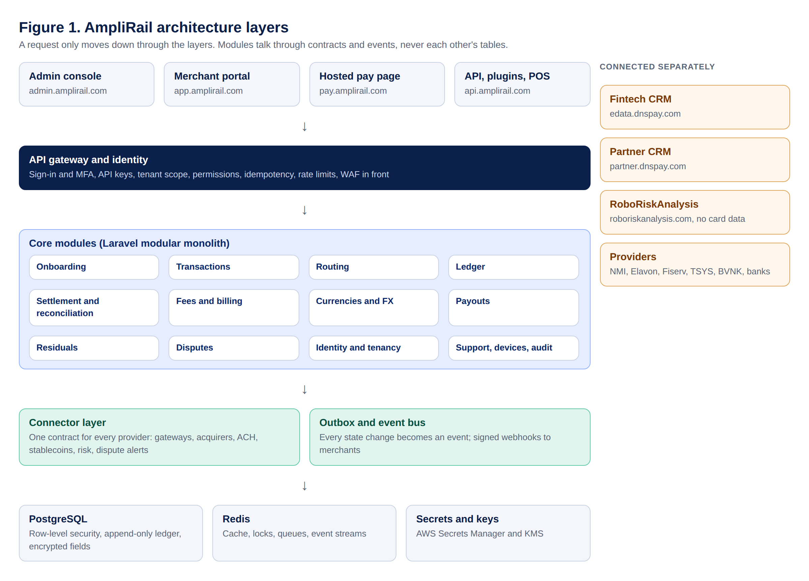
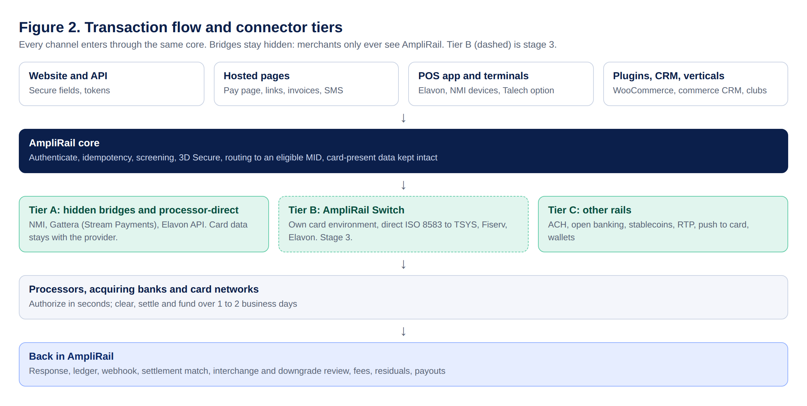
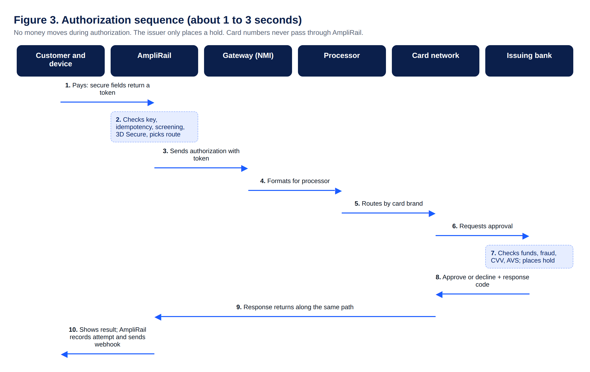
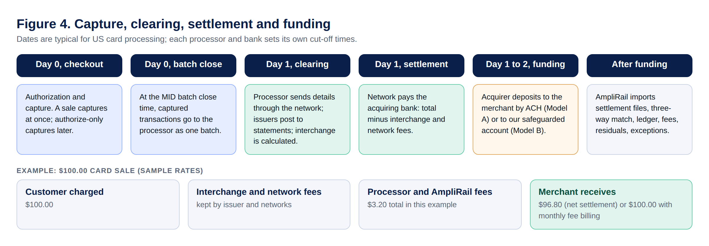
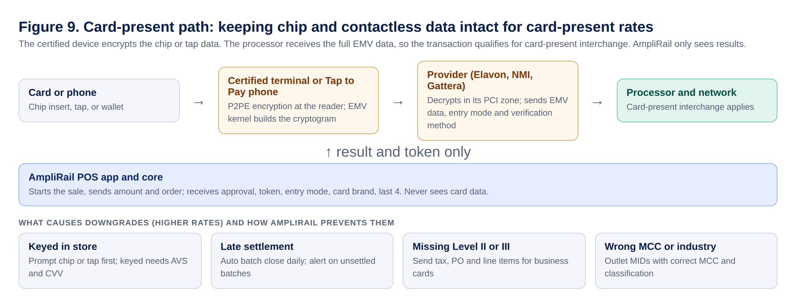
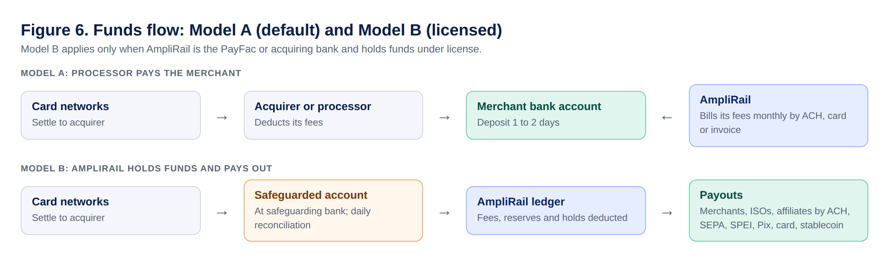
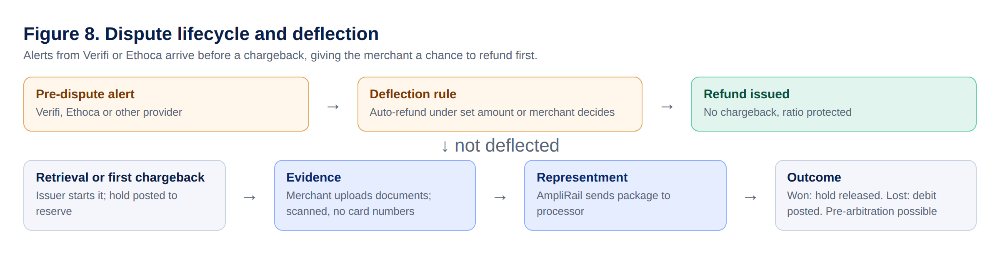
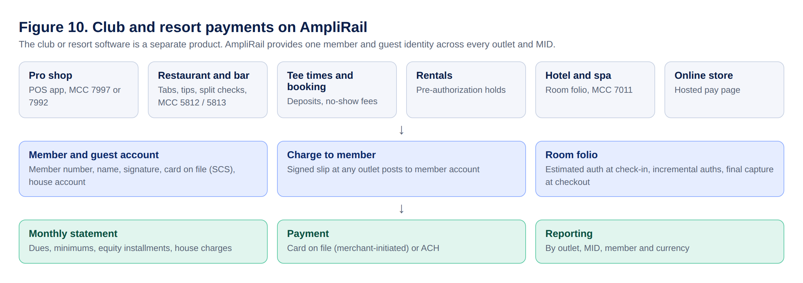
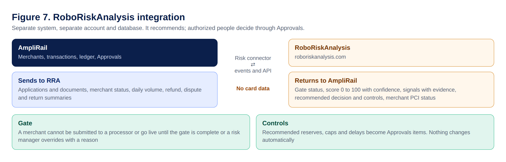
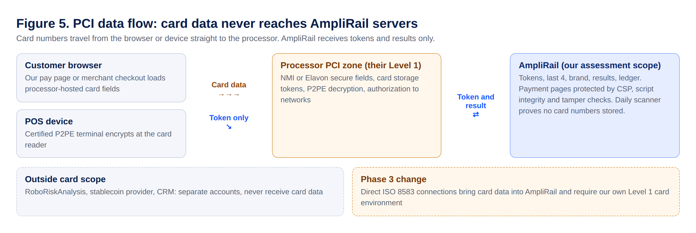

# 0. How to use this document

This is the single controlling development document for AmpliRail 2.0. It replaces the V1 Master PRD and absorbs Mohit's Unified Commerce Platform Architecture (Sep 26, 2026), the Elavon / U.S. Bank Integration Brief, the eDataPay AI Security Review Standard, the Architecture Review of Sep 30, 2026, and the AmpliRail Platform Screens V3 prototype (54 screens).

**Version 3.6 (October 3, 2026)** adds: the high-volume target of 50 million transactions per month with the scale architecture to reach it (Section 4.5), the two-week launch slice on the NMI and Gattera bridges (Section 19.1), electronic payout statements, reserves and PSP reconciliation across multiple acquirers, MIDs and providers (Section 9.9), rewards issuing with prepaid cards and vouchers (Section 9.10), AmpliPay as gateway and payment provider of record with card brand registration (Section 14.8), hidden bridges (NMI and Gattera) and paid add-ons, processor-direct and terminal options (Elavon API, Elavon terminals and Talech, NMI devices), card-present data integrity and downgrade prevention (Section 7.8), the stage 3 AmpliRail card environment (Section 7.9), the commerce CRM (Section 9.7), club, hotel and resort payment capabilities (Section 9.8), the competitive gap items (wallets, stored credential flags, account updater, network tokens, open banking, global accounts, conversion insights), the AI toolchain policy (Section 18.1), and five new screens. **Version 3.5** added: eight developer diagrams (Figures 1 to 8), the integration methods under AmpliRail's own names (Section 7.4), the full transaction lifecycle from authorization to funding (Section 7.5), connector tiers including the phase 3 direct ISO 8583 plan (Section 7.6), eight processing controls found in the gateway benchmark review (Section 7.7), and a clean-room rule for third-party documentation (rule 13). **Version 3.4** added: merchant types (eCommerce online, POS and terminals, mobile, test), Fiserv, TSYS and other processors, the complete merchant processing setup (acquirer MID, TIDs, MCC, card brands and card types, velocity), portfolios with TPV, refund and chargeback ratios by acquirer, MID and card brand, card-type and decline-reason reports, chargeback alerts and dispute representment through third-party providers, cost and sell rates in fees, and two kinds of residuals (Sections 9.1 to 9.6, 10.1). **Version 3.3** added: a configurable fees and billing engine with merchant fee agreements (Section 9.2), multi-currency processing and an optional currency conversion app with markup (Section 9.3), and merchant payouts when AmpliRail holds funds under its own money license (Section 9.4). **Version 3.2** added: RoboRiskAnalysis as a separate merchant-risk platform integrated through a connector (Section 10.2), the PCI DSS v4.0.1 control map and fast-track plan with the extra code and evidence needed to pass (Sections 14.5 to 14.7), a PCI compliance screen, stricter admin sign-in (authenticator or security key, 15-minute timeout), and neutral terminology with no other providers' product names (rule 12). **Version 3.1 (September 30, 2026)** added: emailed one-time code sign-in, Terms and Privacy on every page, payment rails (cards, ACH and eCheck, stablecoins), integration methods, merchant setup with risk, velocity, reserves, blocking rules and dynamic descriptors, NMI-style reporting with batch integrity, merchant wallet and payouts, traffic and performance tracking, rewards, gift and debit cards, subscriptions and memberships, merchant settings, and a full ticket backlog (Appendix H).

> **RULE FOR EVERYONE:** If code, a ticket, a prompt or a conversation conflicts with this document, this document wins. Changes to this document need an ADR (architecture decision record) approved by Mohit and Adam.

| Reader | Start with | Then |
| --- | --- | --- |
| Adam (owner) | Sections 1, 2, 20, 25 | Approve open items in Section 25 |
| Mohit (technical owner) | Sections 2 to 17 | Load the repo starter pack, run Sprint 0 |
| AI coding agents | AGENTS.md (Appendix A) | This document, SECURITY.md, the ticket |
| Designer | Section 12 and the prototype | Brand rules in Section 12.4 |

**Repo starter pack.** The appendices are also delivered as files that go in the root of the amplirail-unified-commerce repository: AGENTS.md, CLAUDE.md, SECURITY.md, docs/MASTER_DEVELOPMENT_DOCUMENT_V3.md, docs/prompts/PROMPT_LIBRARY.md, docs/TASK_TEMPLATE.md, docs/SPRINT_0_TICKETS.md, docs/BACKLOG.md and .github/pull_request_template.md. Claude Code reads CLAUDE.md automatically; other agents read AGENTS.md.

# 1. Mission and non-negotiable rules

AmpliRail is the single payments rail for the AmpliPay / eDataPay ecosystem. The CRM, merchant portal, POS, vertical SaaS (golf, sports, hospitality, healthcare), eCommerce plugins and partner APIs call AmpliRail. Only AmpliRail talks to processors, gateways, banks, KYB providers and RoboRiskAnalysis.

**First proof (Milestone #1):** a management user creates a merchant, AmpliRail automatically provisions a sandbox, a developer sends a $100 Transaction, AmpliRail routes it to the simulator, records the full event history and ledger postings, sends a signed webhook, and shows the timeline in the admin console.

Non-negotiable rules. Breaking any of these is a blocking review finding:

1. No application integrates directly with a processor. Everything goes through the AmpliRail connector contract.
2. No raw card number (PAN) or CVV is ever stored, logged or passed through AmpliRail core, the CRM or any portal. Card entry uses processor-hosted fields; POS uses certified P2PE / semi-integrated devices.
3. Money is integer minor units plus a currency code (ISO 4217 for fiat, using each currency's own decimals, for example 0 for JPY; stablecoins use their own code and 6 decimals). Floats are banned for amounts. Amounts in different currencies are never added together without an explicit, recorded conversion.
4. The ledger is append-only double entry. Corrections are reversing postings. No UPDATE or DELETE.
5. Every mutating API call requires an idempotency key.
6. Every state change emits an immutable event through the transactional outbox.
7. Tenant isolation is enforced twice: application scope and PostgreSQL row-level security. Queries without a tenant context fail closed.
8. Secrets never appear in code, .env files in production, prompts, tickets, logs or AI conversations.
9. AI agents build in bounded tasks through pull requests. Humans approve merges and every production deployment.
10. Hard issuer declines are never retried on another route.
11. Naming: AmpliRail's stored-card feature is called **Secure Card Storage (SCS)**. Never use the word "vault" in product names, UI text, API names, code identifiers or documents (third-party trademark).
12. Neutral terminology: never use other payment companies' product or object names in AmpliRail product names, UI, APIs or code (for example Radar, Connect, PaymentIntent, Smart Retries, or pk_/sk_/whsec_ key prefixes). AmpliRail names: Transaction and TransactionAttempt, RoboRiskAnalysis for merchant risk, transaction screening rules, automatic retries, and API key prefixes arpub_ (publishable), arsec_ (secret), arrst_ (restricted) and arwhk_ (webhook secret), each followed by sbx_ or live_. 
13. Clean room: AmpliRail's own API, field names, screens and product names are designed from public standards (REST, OpenAPI, ISO 8583, EMV, card-network rules) and this document. Third-party gateway documentation (for example NMI's) is used only inside that provider's connector folder (docs/providers/<provider>/) to integrate with it, never pasted into prompts or tickets for AmpliRail's own features, and never copied into AmpliRail code, docs or UI.
14. Card-present integrity: card-present transactions carry the device's EMV or contactless data to the processor unchanged and are never converted to keyed or e-commerce format (Section 7.8).
15. MID routing compliance: route only to MIDs boarded for the same merchant, business name and descriptor; never route to hide chargeback ratios or to process one business's sales on another's MID (Section 9.7).

# 2. Decisions locked for Phase 1

These decisions resolve the nine open items in Mohit's architecture document. Items marked Confirm need Adam's sign-off in Section 25 but agents build to the stated default.

| # | Decision | Phase 1 answer | Status |
| --- | --- | --- | --- |
| D1 | First processor | NMI (already live as the eData Executive Gateway). Elavon second, after the Solution Engineer session. | Locked |
| D2 | Secure Card Storage (SCS) | No in-house card storage. Use processor tokens: NMI stored-card tokens with Collect.js hosted fields; Elavon hosted tokenization after SE confirms the product path. scs/ stays an interface and README only. | Locked |
| D3 | Event bus | Redis Streams behind an EventPublisher interface. Kafka only if measured load requires it. | Locked |
| D4 | Hosting | AWS, us-east-1 primary and us-east-2 for disaster recovery, separate AWS accounts for sandbox, staging, production and backups. Not the existing CWP Pro servers. | Confirm |
| D5 | Card data in current CRM | Audit now (ticket AR-002). Purge any PAN or CVV found. Never migrate card data. | Locked |
| D6 | KYB / identity provider | Behind a KYBProvider connector. Vendor chosen through RoboRiskAnalysis after comparing two or three vendors. Simulator KYB connector for Phase 1. | Confirm |
| D7 | Risk check failure mode | Fail closed for onboarding decisions and high-risk MCCs (for example 7995). Fail open with an alert for transaction checks on low-risk tiers. Configurable per ISO. | Locked |
| D8 | Team | One named rail owner (Mohit) separate from CRM work. AI agents do the bulk of implementation under Section 18. | Locked |
| D9 | PCI target | PCI DSS v4.0.1 Level 1 Service Provider Report on Compliance and AOC signed by a QSA (Mastercard treats a merchant payment gateway as Level 1 at any volume; Visa's service-provider registry needs a QSA ROC). Smallest possible scope: hosted fields plus P2PE, no PAN or CVV on our systems. | Locked |
| D10 | Stack | Laravel 12, PHP 8.3+, PostgreSQL 16, Redis 7, modular monolith with hexagonal module boundaries. | Locked |
| D11 | Backups | Managed PostgreSQL point-in-time recovery plus immutable cross-account, cross-region copies. Never Dropbox or Google Drive for data. | Locked |
| D12 | Recovery targets | RPO 5 minutes, RTO 4 hours for production. | Confirm |
| D13 | Sign-in second factor | Merchant portal: email and password, then an emailed 8-digit one-time code (10 minutes, single use). Admin console: authenticator app or security key required (emailed code not allowed for admins, PCI DSS 8.4 and 8.5). Super admin: security key plus IP allowlist. Idle timeout 15 minutes for admin and super admin (PCI DSS 8.2.8). | Locked |
| D14 | Payment rails | Cards; ACH and eCheck (via NMI first); stablecoins (USDC, USDT) via BVNK or an equivalent provider. Every rail goes behind the connector contract. | Confirm provider |
| D15 | Zelle | Not supported: no gateway or merchant API as far as we know. Offer ACH, pay-by-bank links and RTP/FedNow request for payment instead. | Locked |
| D16 | Regulated features | Built behind feature flags and switched on only after the partner or license is in place: consumer stored-value wallet, card issuing (debit and prepaid), dynamic descriptors as a PayFac, gaming state geofencing, gift cards. | Locked |
| D18 | Merchant risk platform | RoboRiskAnalysis is built and deployed as its own product (repo roboriskanalysis, roboriskanalysis.com, own AWS account and database) and is also used inside AmpliRail through the risk connector. It takes over the merchant-risk role earlier planned as AmpliGuard. Transaction screening rules (velocity, blocks, card testing) stay inside AmpliRail. | Confirm name |
| D19 | PCI fast track | Track A now: sell under NMI's PCI Level 1 coverage and keep NMI and sponsor-bank AOCs on file. Track B in parallel: AmpliRail's own ROC and AOC in 8 to 12 weeks (Section 14.6). | Locked |
| D20 | Fees | One fees engine for every payer (merchant, ISO, PSP, bank). Fees are built as configurable rules per client, effective-dated, and only become active after the client signs the fee agreement. New fee types are added by configuration, not code. | Locked |
| D21 | Currencies | Each MID has one processing and settlement currency. Transactions, settlement, payouts and reports show the MID's currency. Launch set: USD, EUR, JPY, MXN, GBP, INR, CAD, BRL (with Pix) and DOP; more added by configuration. | Locked |
| D22 | Currency conversion | Optional app, off by default, per merchant. Rates from a contracted FX rate provider ([FX rate provider]); AmpliRail adds a markup (default 1.5%, configurable per merchant, needs approval). Refund and payout conversion policy set per merchant and shown in the fee agreement. | Confirm provider |
| D23 | Funds flow | Model A (default): the processor or acquirer pays the merchant and AmpliRail bills its fees. Model B: funds settle to AmpliRail's safeguarded account under its money license; AmpliRail deducts fees and pays merchants, ISOs and affiliates. Model B stays behind a feature flag until the license, safeguarding bank and counsel sign-off are in place (D16). | Confirm license |
| D24 | Merchant types | eCommerce online, POS and terminals, mobile, and test. A merchant can hold more than one type through separate MIDs. | Locked |
| D25 | Processors | NMI first; Elavon after the Solution Engineer session; Fiserv (First Data) and TSYS (Global Payments) as next connectors; any other processor added as a connector without changing merchant APIs. | Locked |
| D26 | Payouts scope | AmpliRail pays merchants only when it is the PayFac or the acquiring bank and holds funds under license (Model B). Otherwise the processor or acquirer pays merchants and AmpliRail pays only agents and affiliates. | Locked |
| D27 | Connector tiers | Tier A: gateway connectors (NMI first, Elavon, [other gateway]); card data stays with the gateway. Tier B: direct host connections over ISO 8583 (TSYS, Fiserv, Elavon) in phase 3 only, with our own PCI Level 1 card environment and host certification. Tier C: other rails (ACH, stablecoins, RTP, push to card). | Locked |
| D28 | Provider of record | AmpliPay is the gateway and payment platform of record: merchants contract with and see only AmpliRail. Track: PCI DSS Level 1 Service Provider ROC and AOC, registration by the sponsor acquirer with Visa (third-party agent) and Mastercard (service provider), listing on both brands' service provider registries, and PayFac registration (Section 14.8). | Locked |
| D29 | Bridges and add-ons | NMI and Gattera (Stream Payments) are hidden bridges behind connectors; merchants never see or log in to them. AmpliRail's own processor-direct and Switch connectors are the default as they come online. A bridge can also be sold as a paid add-on (for example Tap to Pay through NMI). | Locked |
| D30 | Card-present integrity | In-store payments run on certified terminals or Tap to Pay and carry full EMV chip or contactless data to the processor so they qualify for card-present interchange. AmpliRail never downgrades card-present data to keyed or e-commerce format. | Locked |
| D31 | AI toolchain | One primary builder (Claude Code), an independent second model for review, business or enterprise plans only, open-weight models only when self-hosted (Section 18.1). | Locked |
| D32 | Vertical software | Club, golf, hotel and resort management software is a separate product built on the AmpliRail API. AmpliRail provides the payment capabilities in Section 9.8. | Locked |
| D33 | Rewards program levels | Closed-loop offers (one merchant or affiliated outlets) are built now; network vouchers and wallet transfers stay behind feature flags until a money license or issuing partner and counsel sign-off are in place (Section 9.10). | Locked |
| D34 | Volume target | Design for 50 million transactions per month (about 1.7 million per day; 20 per second average) with peak capacity of 1,000 transactions per second and room to scale beyond. Load tests prove each step before volume grows (Section 4.5). | Locked |
| D35 | Launch bridges | Launch on the NMI bridge (US, existing connectors) and the Gattera bridge (EU acquiring banks), then add processor-direct and other providers once the PCI Level 1 certificate is issued. | Locked |
| D17 | Crypto custody | AmpliRail never holds customer or merchant private keys. Custody, licensing and conversion stay with the stablecoin provider. | Locked |

# 3. System boundaries, repositories and subdomains

| System | Owns | Integrates with AmpliRail by |
| --- | --- | --- |
| Fintech CRM (edata.dnspay.com) | Deals, applications, commercial relationship, original agent | Calls AmpliRail API; listens to merchant.* events |
| Partner CRM (partner.dnspay.com) | Agents, ISOs and resellers viewing their pipeline | Reads merchant status via events and API |
| RoboRiskAnalysis (separate product and repo: roboriskanalysis; roboriskanalysis.com) | Merchant underwriting, pre-submission gate, PCI profile, card-brand screening, related-entity memory, scoring, recommended controls, monitoring, evidence store | Risk connector (RiskDecision interface) and events; separate AWS account and database; no card data (Section 10.2) |
| mvpay (separate repo) | Media and merchant growth | API only |
| AmpliRail (repo: amplirail-unified-commerce) | Merchant payment config, payments, routing, ledger, settlement, residual data, webhooks, connectors, admin and merchant portals | This system |
| eData Executive Gateway (secure.edataexecutivegateway.com) | Current NMI-based gateway | Merchants migrate over time; read-only link from admin |
| amplirail.com | Marketing site and lead forms | Leads go to the Fintech CRM, never to AmpliRail directly |

> **BOUNDARY RULE:** Systems never share databases. They integrate through versioned APIs and events only.

Proposed subdomains: admin.amplirail.com (admin console), app.amplirail.com (merchant portal), ops.amplirail.com (super admin, Phase 2), api.amplirail.com (public API), sandbox-api.amplirail.com, docs.amplirail.com, status.amplirail.com, id.amplirail.com (identity and single sign-on), and pay.amplirail.com (hosted payment page and payment requests). Merchants may add a custom subdomain such as pay.merchant.com by CNAME, verified before use. All GitHub repositories live in a company-owned GitHub organization (see Section 24).

# 4. Architecture

AmpliRail has six layers and a request only ever moves down through them.

| Layer | Responsibility | Owns |
| --- | --- | --- |
| Channels | Admin console, merchant portal, POS, plugins, partner integrations | UI state only, never money state |
| API gateway and identity | Authentication, SSO, tenant resolution, RBAC, idempotency, rate limiting | API keys, OAuth clients, sessions, idempotency records |
| Core services | Onboarding, payments, routing, ledger, settlement, residuals, pricing, support, audit | Domain data, one schema per module |
| Connector layer | Translates the canonical model to each provider | Provider credential references, masked request/response logs |
| Event bus | Delivers domain events to internal consumers and webhooks | Nothing persistent beyond retention |
| Token boundary | Processor-hosted fields and processor token storage (Phase 1) | Nothing in AmpliRail except token references |



## 4.1 Architecture principles

| Pattern | Applies to | Reason |
| --- | --- | --- |
| Hexagonal (ports and adapters) | Every module | Domain logic never imports a provider SDK |
| Modular monolith first | Core services | One deployable; extract a service only under measured load |
| Canonical data model | All APIs and events | Providers are swappable |
| Strategy pattern | Routing, fees, residual plans | Configurable per tenant without code changes |
| State machine | Merchant, payment, payout, ticket lifecycles | Only legal transitions; each transition audited |
| Transactional outbox | Every write that emits an event | Commit and publish can never disagree |
| Idempotency keys | Every mutating call | No double charges on retry |
| Orchestrated saga | Onboarding, refunds, payouts | Compensating actions instead of distributed transactions |
| Append-only ledger | All money movement | Balances derived, never edited |
| CQRS for reporting | Dashboards and reports | Heavy reads never touch the payment path |

## 4.2 Module boundary rules

1. A module owns its tables. No other module reads or joins them.
2. Modules talk through a published interface in their Contracts folder or through events, never through another module's models.
3. IDs are prefixed ULIDs: org_, usr_, mer_, macc_, txn_, tat_, rf_, led_, stl_, po_, evt_, whk_, tkt_, dev_.
4. Deptrac or Pest architecture tests fail CI if a module imports another module's internals.

## 4.3 Technology stack

| Concern | Choice |
| --- | --- |
| Core application | Laravel 12, PHP 8.3+, Octane for the payment API |
| Database | PostgreSQL 16 (AWS RDS or Aurora), row-level security, pgaudit |
| Cache, locks, queues, bus | Redis 7 (ElastiCache), Laravel Horizon, Redis Streams |
| Admin and merchant portals | Laravel + Inertia with Vue 3 or React (Mohit to confirm in ADR-0003), Tailwind |
| Object storage | S3 with KMS encryption, private buckets only |
| Secrets and keys | AWS Secrets Manager and KMS |
| Infrastructure | Docker, ECS Fargate or EKS, Terraform, separate AWS accounts per environment |
| Observability | OpenTelemetry, Grafana or Datadog, Sentry, trace ID on every request and event |
| CI | GitHub Actions: PHPStan level 8+, Pest, contract tests, architecture tests, OpenAPI diff, dependency and secret scanning |

## 4.4 Repository layout

```
amplirail-unified-commerce/
  AGENTS.md  CLAUDE.md  SECURITY.md
  app/                 HTTP kernel, gateway middleware
  modules/
    Identity/          users, roles, permissions, SSO, sessions, sign-in log
    Tenancy/           org nodes, TenantContext
    Onboarding/        merchant saga, KYB
    Payments/          intents, attempts, state machine
    Routing/           routing strategies, eligibility
    Ledger/            postings, entries, balances
    Settlement/        ingestion, reconciliation, payouts
    Residuals/         plans, statements
    Pricing/           fee plans
    Webhooks/          subscriptions, deliveries
    Support/           tickets, SLAs, knowledge base
    Devices/           terminals, orders, pairing
    Audit/             immutable audit trail
    MerchantProducts/  virtual terminal, invoices, links, subscriptions, customers, products
    (each: Domain/ Application/ Infrastructure/ Http/ Contracts/ Tests/)
  connectors/
    Contracts/  ContractTests/  Simulator/  Nmi/  Elavon/  KybSimulator/
  scs/               README only in Phase 1 (decision D2)
  openapi/             API contract (source of truth)
  infra/               Terraform, environments, backup policies
  docs/                this document, ADRs, prompts, tickets
  tests/
```

## 4.5 High-volume architecture (50 million transactions per month)

**Targets**

| Measure | Target |
| --- | --- |
| Monthly volume | 50,000,000 transactions (authorizations, captures, refunds and ACH items) |
| Average and peak | About 20 per second average; designed for 1,000 per second peak (holiday and flash-sale spikes), scalable further by adding capacity |
| AmpliRail added latency | Under 150 ms at the 95th percentile, excluding provider time |
| Availability | 99.95% for the payment API; no single point of failure |
| Ledger postings | Up to about 200 million rows per month (2 to 4 postings per transaction) |

**Design rules**

1. Stateless API and worker containers (Laravel Octane on ECS Fargate) that scale out automatically on CPU and queue depth; no session state on servers.
2. The payment hot path does only what is needed to authorize: key check, idempotency, screening, routing, connector call, write the attempt and outbox event. Everything else (webhooks, reports, fees, residuals, statements) runs asynchronously from events.
3. PostgreSQL with monthly partitions for transactions, attempts, ledger postings, events and audit; PgBouncer connection pooling; read replicas for portals and reports; older partitions archived on schedule.
4. Idempotency keys and rate limits in a Redis cluster; locks with short timeouts.
5. Event bus behind the EventPublisher interface: Redis Streams at launch, with a planned move to a managed streaming service (for example Amazon MSK) before sustained volume passes the threshold set by load tests.
6. Reporting reads from rollup tables and a separate analytics store, never from the live payment tables.
7. Connectors use timeouts, retries only where safe, circuit breakers and per-provider concurrency limits, so one slow provider never slows the others.
8. Multi-zone deployment in us-east-1 with the DR region; database failover tested; payment API behind a global load balancer and WAF.
9. Observability: request tracing across connectors, dashboards for approval rate, latency and error rate per connector, alerts on SLO breach.

**Load testing (gate before each volume step):** scripted load tests in staging against the simulator at 2 times the next target (for example 200, 500, then 1,000 per second sustained for 1 hour), with no lost or duplicated transactions, ledger in balance, and latency within target. Results are kept as evidence.

**Cost at volume.** Per-transaction bridge fees grow with volume (a few cents per transaction at 50 million transactions a month is a large monthly cost), which is why processor-direct connectors and the AmpliRail Switch (Section 7.9) move up the plan as volume grows.

# 5. Roles, portals, tenancy and identity

## 5.1 Portals and roles

| Portal | Who | Sign-in requirement |
| --- | --- | --- |
| Super admin (ops.amplirail.com, Phase 2) | Platform owner staff; manages admin organizations, global connectors, platform audit | Security key (WebAuthn), IP allowlist, session 15 min idle |
| Admin console (admin.amplirail.com) | eDataPay staff: owner, operations, finance, underwriter, support agent, developer, read only | Email + password + authenticator app or security key, or company SSO with MFA; session 15 min idle |
| Merchant portal (app.amplirail.com) | Merchant owners and staff | Email + password + emailed 8-digit code; step-up code for refunds above threshold and bank account changes |
| Partner access | Agents, ISOs, resellers | Partner CRM for now; AmpliRail exposes read APIs scoped to their node |

## 5.1.1 Sign-in flow (required)

1. Sign-in page: portal, email, password, forgot password, SSO option, links to Terms of service and Privacy policy.
2. Merchant portal: after a correct password, send an 8-digit numeric code by email. Admin console: ask for the authenticator code or security key instead (no emailed codes for admins). Store only a hash of the code. Expires in 10 minutes, single use, resend allowed after 45 seconds, maximum 5 codes per hour.
3. Five wrong codes or passwords lock the account for 30 minutes and alert the user.
4. New device or location sends an email alert and is flagged in the sign-in log.
5. Every page of every portal shows a footer with Terms of service, Privacy policy, Security and System status. Legal text is supplied by counsel ([Terms], [Privacy]).

## 5.2 Tenancy

Tenancy follows the payments hierarchy: platform → organization (admin tenant) → ISO → sub-ISO/ISV → agent → merchant → location. Table org_nodes stores id, type, parent_id, materialized path (for example /plt_1/org_1/iso_7/agt_42/mer_901/) and status. Every domain row carries org_node_id. Visibility is a path-prefix match. Roles are granted at a node and inherit downward. Configuration (pricing, routing, residual splits) inherits downward unless overridden.

## 5.3 Permissions (minimum set)

merchants.view, merchants.create, merchants.edit, merchants.go_live.approve, payments.view, payments.refund, payments.void, routing.view, routing.draft, routing.publish, recon.view, recon.resolve, risk.view, risk.decide, residuals.view, residuals.approve_payout, users.manage, roles.manage, api_keys.manage, webhooks.manage, support.view, support.reply, devices.manage, audit.view, settings.security.manage, merchants.risk.edit, merchants.limits.edit, merchants.descriptors.edit, merchants.view_as (read only, logged), wallet.view, payouts.instant, rewards.manage, giftcards.manage, traffic.manage, apikeys.merchant.manage, reports.export, fees.view, fees.manage, fees.approve, billing.manage, fx.manage, fx.approve_markup, payouts.accounts.verify, currencies.manage.

Sensitive permissions (payments.refund above a threshold, routing.publish, risk.decide, residuals.approve_payout, roles.manage, agent attribution override) require step-up MFA, and those marked dual-control need a second approver.

## 5.4 Sign-in and session logging (required)

Every sign-in, sign-out, failed attempt, lockout, MFA challenge, password reset, new-device sign-in and session expiry writes an auth event: user, portal, IP, user agent, approximate location, method, result, timestamp and correlation ID. The Management screen shows this log with filters and CSV export. Lock after 5 failed attempts for 30 minutes. Alert the user by email on new device or location.

# 6. Canonical domain model and state machines

| Entity | Key fields |
| --- | --- |
| OrgNode | id, type, parent_id, path, status |
| User | id, email, name, mfa methods, status; memberships (org_node_id, role) |
| Merchant | id, org_node_id, crm_deal_id (immutable), legal name, DBA, MCC, KYB status, risk tier, original agent (locked) |
| MerchantAccount | merchant_id, connector_id, provider MID/TID reference, environment, status, pricing plan |
| Location | merchant_id, address, devices |
| PaymentMethod | provider token reference, brand, last4, expiry, network token flag, customer_id |
| Transaction | amount_minor, currency, channel, capture mode, status, idempotency key, route list |
| TransactionAttempt | intent_id, merchant_account_id, provider reference, canonical status, decline category, AVS/CVV result |
| Refund | intent_id, amount_minor, reason, status, provider reference |
| LedgerAccount / Posting / Entry | see Section 9 |
| SettlementBatch / SettlementRecord | provider, batch date, gross, fees, net, reconciliation status |
| Payout | merchant_id, amount_minor, bank account token, rail, status |
| Dispute | intent_id, amount, reason code, status, deadlines |
| SupportTicket | merchant_id, category, priority, channel, SLA due, assignee, status |
| Device | merchant_id, location_id, model, serial, connector, status |
| OtpChallenge | user_id, code hash, expires_at, attempts, consumed_at |
| ApiKey | org_node_id, type (publishable, secret, restricted), environment, scopes, IP allowlist, hash, last used |
| MerchantRiskProfile | merchant_id, MCC primary and secondary, tier, reserve type, percent, hold days, funding delay |
| VelocityLimit | merchant_id, metric, window, threshold, action (decline, hold, alert, approval) |
| BlockRule | org_node_id, type (BIN, ICA, issuing bank, country, US state, email domain, IP), value, scope, expires_at |
| Descriptor | merchant_id, default text, locked prefix, dynamic allowed, city or phone |
| TrafficSource | merchant_id, name, tracked link or subdomain, parameters, postback URL, spend entries |
| Plan / Subscription / Membership | plan price and cycle; subscription payment method and next run; member number, tier, dues, house account balance |
| Invoice / PaymentRequest | line items, tax, due date, allowed methods, channel (email, SMS, link), status |
| LoyaltyAccount / GiftCard | points balance and tier; gift card number (tokenized), balance, status |
| SettlementBatch integrity | gateway count, processor count, processor net, bank deposit, match status |
| FeeType | code, name, category, default basis (flat, percent, per item, per MID, per terminal, per user, tiered), payer types allowed |
| FeeSchedule / FeeRule | owner (merchant, ISO, PSP, bank), version, effective_from and effective_to, rules with conditions (rail, currency, card brand, MCC, channel, MID, volume tier), amount or rate, minimum and maximum, billing method |
| FeeAgreement | fee schedule version, document hash, signer, signed_at, e-signature reference, status (sent, signed, declined, superseded) |
| FeeAssessment | fee rule, source (transaction, batch, MID, terminal, month), amount and currency, billing method, ledger posting |
| BillingStatement / PlatformInvoice | period, lines, totals per currency, collection method (net from settlement, ACH debit, card, wallet), status |
| CurrencyConfig | code, decimals, enabled rails, enabled for processing, settlement and payout |
| FxRate / FxQuote / FxConversion | provider, pair, mid-rate, markup, client rate, quoted_at, expires_at; conversion links source and target amounts and the ledger posting |
| PayoutAccount | owner (merchant, ISO, affiliate), rail (ACH, wire, SEPA, SPEI, Pix, push to card, stablecoin), currency, tokenized details, verification status |

**Merchant states:** draft → submitted → kyb_pending → underwriting → approved → boarding → test_mode → validation → active; side states needs_info, manual_review, declined, suspended, closed. On approved, the system automatically creates a sandbox MerchantAccount on the simulator, a test MID, a sandbox API key pair and a webhook secret.

**Transaction states:** created → pending_authentication → authorized → captured → settled; side states failed, voided, partially_refunded, refunded. Transitions live in one state-machine class. Any other transition throws and is logged.

# 7. Connector framework

Every provider is an adapter implementing capability interfaces. A manifest declares capabilities, currencies, card brands, channels and 3DS support. Routing reads the manifest so unsupported features are never sent.

```php
interface CardProcessor {
  public function authorize(AuthorizeRequest $r): ProviderResult;
  public function sale(SaleRequest $r): ProviderResult;
  public function capture(CaptureRequest $r): ProviderResult;
  public function void(VoidRequest $r): ProviderResult;
  public function refund(RefundRequest $r): ProviderResult;
  public function chargeToken(TokenChargeRequest $r): ProviderResult;
  public function getTransaction(string $providerRef): ProviderResult;
  public function healthCheck(): HealthResult;
}
interface MerchantBoarding { submitApplication(); getBoardingStatus(); }
interface SettlementSource { fetchSettlements(DateRange $range): iterable; }
interface WebhookNormalizer { verify(Request $raw): bool; toDomainEvent(Request $raw): ?ProviderEvent; }
interface BankTransfer { sendCredit(); sendDebit(); }
interface RiskDecision { underwrite(); preAuthCheck(); }
interface KYBProvider { verifyBusiness(); verifyOwner(); }
```

ProviderResult carries canonical status (approved, declined, pending, error), canonical decline category (insufficient_funds, do_not_honor, fraud_suspected, invalid_card, authentication_required, provider_unavailable, timeout), the raw provider code and message, and a retryable flag. Each adapter owns its response-code mapping table.

Inside every adapter: per-connector timeouts, exponential backoff on network errors only, circuit breaker, masked request/response log keyed by attempt ID, credentials fetched from Secrets Manager by reference. Every adapter must pass the shared ContractTests suite.

## 7.1 Simulator connector (first connector, mandatory)

| Test input | Result |
| --- | --- |
| Simulator token tok_sim_approved, any amount not listed below | approved |
| amount ending .02 (for example 10.02) | declined, do_not_honor |
| amount ending .51 | declined, insufficient_funds |
| amount ending .59 | declined, fraud_suspected |
| amount ending .65 | authentication_required |
| flag sim_timeout | timeout, unknown state, retryable |
| flag sim_outage | provider_unavailable, retryable |
| flag sim_avs_fail | approved with AVS mismatch |
| amount 1.23 | partial approval |
| repeated idempotency key | original result returned |

The simulator also emits settlement, funding, refund, chargeback and reversal events using the same schemas and webhook engine as live connectors.

## 7.2 Connector roadmap

| Connector | Category | Phase |
| --- | --- | --- |
| Simulator, KYB simulator | Test | Sprint 1 |
| NMI (cards, ACH and eCheck, Collect.js tokens, NMI stored-card tokens, settlement) | Gateway | Sprint 2 |
| Elavon / U.S. Bank (product path from SE: P365, Lightbox or HPP for CNP; cSDK for POS) | Acquirer | Sprint 3, after SE |
| Fiserv (First Data), TSYS (Global Payments), other processors | Acquirers and processors | After NMI and Elavon, per contract |
| Verifi, Ethoca, Chargebacks911, other | Dispute alerts and resolution | Sprint 5 |
| [BIN data provider] | Card brand and card type (credit, debit, prepaid) | Sprint 5 |
| Gattera (Stream Payments) | Hidden gateway bridge (Level 1); use hosted fields or tokens only | Sprint 3, after API review |
| Elavon terminals, Talech POS | Card-present devices and optional POS plugin | Sprint 4 |
| NMI cloud devices, Tap to Pay on iPhone (NMI) | Card-present through NMI bridge; Tap to Pay as paid add-on | Sprint 6 |
| Apple Pay, Google Pay through processors | Wallets in phase 1 | Sprint 4 |
| Account updater and network tokens (through processors) | Stored-card freshness and portability | Sprint 4 |
| [Open banking provider] | Pay by bank | Expansion |
| [Global accounts provider] | Multi-currency receiving accounts (Model B) | After license |
| ACI Worldwide | Orchestration and acquiring | Evaluate |
| BVNK or equivalent (USDC, USDT) | Stablecoins | Sprint 6, after provider contract |
| Visa Direct | Push-to-card payouts | Sprint 6 |
| [FX rate provider] | Currency rates | Sprint 6 |
| [Brazil PSP] for Pix and BRL cards | Local rail | Expansion |
| [Dominican Republic acquirer] for DOP | Local acquiring (LATAM pilot) | Expansion |
| [Safeguarding bank] payouts: SEPA, Faster Payments, SPEI, Pix, wires | Payout rails (Model B) | After license |
| ACH direct (Nacha rules), RTP / FedNow | Account to account | Expansion |
| Apple Pay, Google Pay, PayPal | Wallets and APMs | Expansion |
| Avvance (U.S. Bank POS lending) | BNPL | Expansion |
| Inabit | Crypto POS | Expansion |
| IDem gateway | Gaming (MCC 7995), LATAM | Expansion |
| EU, UK and LATAM acquirers | Cross-border | Expansion |

> **ELAVON RULE:** Design the connector interface now, but do not code the production Elavon connector until the Solution Engineer confirms the product path, PCI boundary and certification plan. Converge XML requires a Level 1 PCI AOC and must not be chosen without Adam's written approval.

## 7.3 Payment rails and integration methods

| Rail | How it works in AmpliRail | Key rules |
| --- | --- | --- |
| Cards | Sale, authorize, capture, void, refund, credit, token charge | PCI boundary (Section 14.1); 3D Secure when required |
| ACH and eCheck | Debit and credit with SEC code (CCD, PPD, WEB, TEL), check conversion | Nacha authorization stored; returns (R codes) handled like chargebacks |
| Stablecoins | Payment request with QR, rate lock (15 minutes), confirmation after network confirmations, settle as USD or keep as stablecoin | Provider custody only (D17); sanctions screening by provider and RoboRiskAnalysis |
| Payouts | ACH next day; instant push to debit card (Visa Direct); RTP later | Dual control above threshold |

| Integration method | Who uses it | PCI effect for the merchant |
| --- | --- | --- |
| Server-to-server API | Platforms and developers, with tokens | Tokens only: small scope. Raw card data server-to-server needs the merchant's own PCI validation and our written approval |
| Hosted payment page (pay.amplirail.com) | Any merchant | Lowest scope |
| Hosted card fields (JavaScript) | Merchant checkouts | Card data goes straight to the processor |
| Virtual terminal | Merchant staff | Processor-hosted fields |
| Payment requests and invoices | Merchant staff | Hosted page |
| Plugins: WooCommerce first; Shopify (needs Shopify approval), Adobe Commerce, BigCommerce | eCommerce merchants | Hosted fields or page |
| POS devices | In-store | Certified P2PE or semi-integrated only |
| 3D Secure | Automatic when the card, rule or region requires it | Through [3DS provider] connector |

## 7.4 Integration methods (AmpliRail names)

The gateway benchmark review confirmed the feature set merchants expect. AmpliRail provides each capability under its own design and names (rule 13).

| Capability merchants expect | AmpliRail product | Notes |
| --- | --- | --- |
| Server-to-server payments | Transactions API (REST, JSON, tokens) | Raw card data only for PCI-validated merchants with written approval |
| Tokenizing card fields on the merchant's page | Secure Fields (JavaScript) | Processor-hosted fields underneath |
| Fully hosted checkout | Hosted pay page (pay.amplirail.com) | Merchant branding and custom subdomain |
| Buy buttons and simple cart | Pay buttons and payment links | Signed button parameters so amounts cannot be altered; CAPTCHA option |
| Invoices, email and SMS pay requests | Payment requests and invoices | Section 12.2 |
| Stored cards | Secure Card Storage (SCS) | Tokens only |
| Event notifications | Events and webhooks | Signed, retried, replayable |
| Transaction data pull | Reporting API (/v1/reports, /v1/transactions) | Section 9.1 |
| Card-present cloud devices and device SDKs | Cloud POS and Device SDK (iOS, Android, Windows, Linux) | Built on certified device vendors' semi-integrated kits |
| Third-party carts | Plugins | WooCommerce first |
| Merchant boarding by partners | Boarding API (/v1/merchants, /v1/merchant_accounts, /v1/services, /v1/merchants/{id}/status) | Typed settings per connector (Section 7.7) |
| Fraud tools | Transaction screening rules and RoboRiskAnalysis | Optional third-party fraud connectors |
| 3D Secure | 3D Secure connector | No legacy redirect API is needed |

## 7.5 Transaction lifecycle



**Authorization (1 to 3 seconds).** The customer pays through secure fields or a device and AmpliRail receives a token. AmpliRail checks the key and idempotency, runs screening, triggers 3D Secure when needed and routes to an eligible MID. The gateway passes the request to the processor, the processor routes it over the card network to the issuing bank, and the issuer checks funds, fraud, CVV and AVS. The issuer approves or declines with a response code and places a hold on approval. No money moves yet. AmpliRail records the attempt, updates the state and sends the webhook.



**Capture, batch, clearing, settlement and funding (same day to 2 business days).** Sales capture immediately; authorize-only transactions capture later. At the MID batch close time, captured transactions go to the processor as one batch. The processor clears them through the network; issuers post them and interchange is calculated. The network settles to the acquiring bank (total minus interchange and network fees), usually the next business day. The acquirer funds the merchant by ACH (Model A) or funds AmpliRail's safeguarded account (Model B). AmpliRail then imports settlement files and runs the three-way match, ledger, fees and residuals (Section 9).



**Money flowing back.** Refunds travel the same path as a credit and always go to the processor that authorized the sale (or the reroute target, Section 7.7). Chargebacks start at the issuer and arrive through the network and processor into the dispute module (Section 9.6).

**Other rails.** ACH and eCheck move through the ACH network in 1 to 2 business days, with returns (for example R01) usually within 2 business days and consumer unauthorized returns up to 60 days. Stablecoin payments settle on the blockchain after network confirmations; the provider pays out in stablecoin or converts to fiat; there is no interchange or chargeback, and refunds are new outgoing payments.

## 7.6 Connector tiers and the direct ISO 8583 plan

| Tier | What it is | Card data in AmpliRail | When |
| --- | --- | --- | --- |
| A. Hidden bridges and processor-direct | Gateway bridges (NMI, Gattera) and processor-direct APIs with processor-hosted fields (Elavon API first, then Fiserv and TSYS) | No, tokens only (Gattera only with its hosted fields or tokens) | Phase 1 |
| B. Direct host connectors | AmpliRail speaks ISO 8583 (or the host's message spec) directly to TSYS, Fiserv or Elavon hosts | Yes | Phase 3 |
| C. Other rails | ACH, stablecoins, RTP and FedNow, push to card | No card data | As contracted |

**Phase 3 prerequisites (Tier B):** sponsor-bank and host agreement; host message specification and certification for each host and each card brand; our own PCI DSS Level 1 card environment with hardware security modules, key management (including P2PE decryption keys) and segmented network; batch file creation and settlement handling that the processor did before; card-network registration through the sponsor bank. Direct connection to VisaNet or the Mastercard network is available only to members (acquirers) and their registered processors, so access comes through the sponsor bank.

**Connector rule:** Tier B code lives in a separate service ("AmpliRail Switch") inside its own card environment; the rest of AmpliRail keeps calling it through the same connector contract and still never sees card numbers.

## 7.7 Processing controls (from the gateway benchmark review)

| Control | Requirement |
| --- | --- |
| Level III data | Line-item, tax and customer code data for B2B card transactions, sent when the connector supports it, so eligible merchants qualify for lower interchange |
| Split funding | Split a payment between the merchant and one or more partners by percent or fixed amount, for surcharges, platform fees or marketplace payouts (PayFac and Model B) |
| Duplicate transaction check | Per MID: on or off, look-back window in seconds, and whether the merchant may override for one transaction |
| Required fields per MID | Choose which fields every transaction must include: name, company, address, city, state, ZIP, country, phone, email, CVV, or CVV on first use of a card only |
| AVS and CVV pre-check method | Per MID: void on decline (authorize full amount, void if checks fail) or separate small pre-authorization before the full amount |
| Merchant status | Active, restricted (can sign in and report, cannot process), closed (cannot sign in; admins keep reporting and voids) and deleted (only after closed; history kept for reporting and residuals) |
| Refund reroute | When a MID or processor is disabled, its future refunds can be routed to a named active MID |
| Typed connector settings | Each connector defines named, validated settings instead of numbered generic slots. Examples: TSYS (merchant number, acquirer BIN, store number, terminal number, MCC, location number, V number, agent bank, agent chain, MVV, PayFac sub-merchant fields); Fiserv (merchant number, terminal ID, settlement merchant ID); Elavon (bank number, terminal ID, merchant ID) |
| Per-MID limits | Max transaction amount and max monthly volume, with a choice to apply them to all card brands |
| Industry classification | eCommerce, mail or telephone order, retail, restaurant or lodging per MID, limited to what the connector supports |

## 7.8 Card-present processing, terminals and downgrade prevention



**Why it matters.** AmpliRail merchants get their own MID and interchange-plus pricing, so the lower card-present interchange flows to them. Flat-rate providers also process chip and tap transactions, but blend the rate, so the merchant does not see the saving. Card-present pricing only works if the full chip or contactless data reaches the processor.

**Supported in-store options**

| Option | Connector | Notes |
| --- | --- | --- |
| Elavon terminals | Elavon connector (semi-integrated or cloud) | Primary card-present path for Elavon MIDs |
| Talech POS (Elavon) | Optional plugin | For merchants who want Elavon's POS; payments reported into AmpliRail |
| NMI cloud devices | NMI bridge | Card-present through NMI where the MID is on NMI |
| Tap to Pay on iPhone | NMI bridge, paid add-on | Card-present contactless; Apple entitlement required |
| AmpliRail POS app | Any card-present connector above | Register, tabs, tips, member charge (Section 12.2) |

**Card-present rules (rule 14 in Section 1 applies):**

1. Send EMV data, POS entry mode, terminal capability, cardholder verification method and terminal ID exactly as the device produced them; never re-key or convert to e-commerce format.
2. Prompt chip or tap first. A keyed in-store sale requires AVS ZIP and CVV and is flagged as keyed.
3. Close batches automatically every day; alert on any batch not settled within 24 hours.
4. Send Level II (tax, customer code) and Level III (line items) for business and purchasing cards when the connector supports it.
5. Each outlet uses a MID with the correct MCC and industry classification (retail, restaurant, lodging).
6. Tip adjust, incremental authorization and delayed charges follow card brand rules for restaurants and lodging.

**Downgrade review.** AmpliRail compares each settled transaction's qualification with what it should have been and shows the reasons (keyed, late settlement, missing Level II or III, AVS missing, wrong classification) on the Conversion and interchange insights screen.

## 7.9 Stage 3: AmpliRail card environment

Goal: AmpliRail processes without any third-party gateway. Components: a token service (Secure Card Storage operated by AmpliRail) inside a segmented card environment; hardware security modules and key management (including P2PE decryption key handling with a device key-injection partner); direct processor and host connections (ISO 8583 or host specifications) with certification per host and per card brand; EMV terminal certifications for supported devices; batch and settlement file handling; 3D Secure, network tokens and account updater contracts. Built as the separate AmpliRail Switch service (Section 7.6). Requires a full PCI DSS Level 1 assessment of the card environment. Gattera's licensed Level 1 gateway technology is an alternative that can shorten this stage; compare cost and control before building.

# 8. Orchestration and routing

Routing pipeline, in order: eligibility filter (capability, currency, brand, 3DS, merchant actually approved on that account, circuit breaker closed) → rule match (tenant rules inherited down the hierarchy) → scoring (cost, approval rate, latency, weights per ISO) → optional volume split. The ordered route list is stored on the intent so every decision is explainable.

Consistency rules:

1. Check the idempotency key before anything else. A repeated key returns the stored response.
2. Write the attempt row as pending before calling the adapter. A recovery job resolves stuck attempts by querying the provider.
3. Captures, voids and refunds always go to the connector that authorized the payment.
4. Only soft failures (timeout, provider_unavailable) move to the next route. Hard declines are never retried elsewhere.
5. Routing chooses only among accounts the merchant is approved and configured for.
6. Routing policies are versioned. AI may draft a policy; publishing needs routing.publish and a second approver.
7. Phase 1 ships one route per merchant, but the pipeline exists from day one.

# 9. Ledger, settlement, reconciliation, payouts and residuals

**Tables:** ledger_accounts (owner type and id, account type such as merchant_pending, merchant_available, processor_receivable, fee_revenue, residual_payable, reserve; currency), ledger_postings (event type, source reference, effective_at, unique idempotency key), ledger_entries (posting_id, account_id, direction, amount_minor, currency).

**Invariants enforced in code and database:** debits equal credits per currency per posting; the application database user has no UPDATE or DELETE on entries; corrections are reversing postings; ledger_balances snapshot updated in the same transaction and recomputed nightly with an alert on any difference.

**Example, $100.00 captured at 2.9% + $0.30:** debit processor_receivable 100.00; credit merchant_pending 96.80; credit fee_revenue 3.20.

**Settlement and reconciliation:** each connector's SettlementSource ingests files or APIs; raw files archived unchanged in S3 with object lock; three-way match of attempts, settlement records and bank deposits; unmatched items go to an exceptions queue with reason codes (missing_in_rail, missing_in_provider, amount_mismatch, deposit_mismatch, fee_variance); every resolution needs a reason code and is audited.

**Payouts:** move merchant_available minus reserves and RoboRiskAnalysis holds to the merchant's bank on the plan schedule. Payout approval above a threshold is dual control.

**Residuals:** plans are strategy classes per hierarchy node (revenue share, basis points, per transaction, hybrid), effective-dated. A monthly job reads settled margin from the ledger only and posts residual_payable entries. The original agent from the CRM is locked; changes need a management workflow with a second approver. Agents never see another agent's merchants.

## 9.1 Reporting, search and batch integrity

**Transaction search fields:** merchant (admin), transaction ID, order ID, first and last name, email, card last 4, account last 4 or wallet, payment rail, status, transaction type, processor, source, batch ID, customer ID, company, phone, authorization code, PAR, platform ID, date range with quick ranges. 36 months searchable online, older in archive. Large searches run in the background and email the user when ready. Export to CSV and Excel.

**Report tabs:** transactions (all rails in one list); settled batches matched to bank deposits; chargebacks together with ACH and eCheck returns; snapshot grouped by merchant, batch, rail, processor, card brand, source or agent; transaction detail with full action history, print and email receipt, create subscription, create order template, save to SCS, refund.

**Batch integrity (no lost transactions or batches):**

1. Every attempt must reach a final state within 24 hours; the recovery job queries the provider otherwise.
2. Transaction IDs are checked for sequence gaps.
3. Nightly pull of each processor's batches compared with the gateway count and amount.
4. Batch net compared with the bank deposit (three-way match).
5. Alert if a processor file or batch has not arrived by 06:00 Eastern.
6. Raw settlement files archived unchanged with object lock.

Any mismatch opens a reconciliation exception with a reason code and appears on the Reports batch integrity tab.

**Portfolios:** a Global portfolio of all merchants, broken down by acquirer or processor, ISO or agent. For any portfolio, merchant or MID, and for any period: TPV, refund amount and refund %, chargeback count and chargeback % (by count and by amount), approval rate, and active MIDs. Every view can be split by card brand (Visa, Mastercard, American Express, Discover and others) with merchant totals. Each currency is reported separately.

**Card brand and card type reports:** volume, approval rate, refunds and chargebacks by card brand, and by card type (credit, debit, prepaid) using a BIN data provider connector. Merchants can block prepaid cards per merchant, MID or traffic source (common for affiliate traffic).

**Decline reports:** approval and decline ratios, decline counts by issuer reason and response code, soft versus hard declines, card type most affected, and retry advice. Merchants see the same reports for their own MIDs.

## 9.2 Fees, pricing and billing engine

AmpliRail bills its own fees separately from card-network pass-through costs (interchange and network assessments). Every fee is a configurable rule; Mohit's team adds new fee types by configuration as the business needs them.

**Who can be billed:** merchants, ISOs and resellers, PSPs and banks that use AmpliRail, and partners. Each payer has its own fee schedule, inherited down the hierarchy (platform → ISO → merchant) unless overridden.

**Starting fee catalog (extend as needed):**

| Category | Fee types |
| --- | --- |
| Transaction | Gateway per-transaction fee, percentage markup, authorization fee, AVS fee, batch fee, decline fee |
| Stored credentials | Every card-on-file charge is flagged as customer-initiated or merchant-initiated (recurring, installment, unscheduled) with the original transaction reference, as card brand rules require |
| Rails | ACH and eCheck per item, ACH return fee, stablecoin payment fee, Pix and other local-rail fees |
| Account | Setup fee, monthly fee, statement fee, monthly minimum, per MID monthly fee, per terminal monthly fee, per user fee |
| Services | Gateway fee, security fee, media fee, PCI program fee, Secure Card Storage (SCS) token fee, card updater fee, text-to-pay fee, wallet access fee, connector fees (bank, app, plugin) |
| Risk and disputes | Chargeback fee, retrieval fee, Rapid Dispute Resolution (RDR) fee, high-risk monitoring fee |
| Money movement | Currency conversion markup, crypto conversion fee, crypto payout fee, instant payout fee, wire fee |
| Partner payouts | Affiliate, ISO and agent payouts (residuals) are payables, not fees, and are calculated in the residuals module |

**Cost and sell:** every fee line carries our cost (buy rate from the provider, bank or contract) and the sell rate charged to the client; the margin is calculated and feeds residuals. Each client schedule can override the sell rate; cost comes from the provider contract.

**Fee rule bases:** flat amount, percentage, per item, per MID, per terminal, per user, per month, volume tiers, with minimums, maximums and caps. Conditions can target rail, currency, card brand, MCC, channel, MID, terminal or connector.

**Billing methods:** deduct from settlement (net, Model B), daily or monthly; ACH debit from the merchant's bank (Model A); charge a card on file; deduct from the merchant wallet; or issue an invoice.

**Rules:**

1. A fee schedule is versioned and effective-dated. Changes go through Approvals.
2. A fee only applies after the payer signs the fee agreement for that version (electronic signature, document hash stored). Unsigned changes stay pending.
3. Every assessed fee is a ledger posting (debit the payer, credit fee_revenue in that currency) linked to its source.
4. Monthly statements show every fee line, the rule that produced it and the agreement version.
5. Card-network pass-through costs are shown separately from AmpliRail fees.

## 9.3 Multi-currency processing and currency conversion

**Processing currency:** each MID has one processing and settlement currency. Transactions, settlement batches, payouts, fees and reports use that currency. Reports always show amounts in the original currency; an optional reporting-currency view converts at a stored daily reference rate and is labeled as an estimate.

**Launch currencies:** USD, EUR, JPY (0 decimals), MXN, GBP, INR, CAD, BRL (with Pix through a Brazilian provider connector) and DOP (through a Dominican Republic acquirer connector, supporting the LATAM pilot). New currencies are added by configuration once a connector supports them.

**Currency conversion app (optional, per merchant):** needed when the merchant prices in one currency and the MID settles in another (for example, selling in USD on a Mexican MID), or when a payout goes out in a different currency or in stablecoins.

1. Rates come from a contracted FX rate provider through an FxRateProvider connector. Each conversion stores provider, pair, mid-rate, markup and client rate with full precision.
2. Markup is a fee rule (default 1.5% above the provider rate), configurable per merchant and approved through Approvals.
3. Quotes have an expiry (for example 15 minutes for payments, 60 seconds for payouts). Expired quotes are re-quoted, never reused.
4. Refund policy is chosen per merchant and written into the fee agreement: refund at the original rate (merchant absorbs the difference) or at the current rate.
5. Ledger: each currency has its own accounts. A conversion is one posting with legs in both currencies and the markup credited to fx_revenue. Balances are never summed across currencies.
6. Rounding: half-up to the currency's minor unit, at the final step only.
7. If a cardholder is ever offered a choice of currency at checkout, that is dynamic currency conversion and card-network rules apply; it needs a separate compliance review before it is offered.

**Crypto payouts:** a merchant may choose stablecoin payouts (USDC, USDT) through the stablecoin provider. Conversion rate, network fee and AmpliRail's crypto payout fee are shown before confirmation. Custody stays with the provider (D17).

## 9.4 Funds flow and merchant payouts

| Model | Who holds funds | Who pays the merchant | How AmpliRail gets paid |
| --- | --- | --- | --- |
| A (default) | Processor or acquirer | Processor or acquirer | Monthly statement collected by ACH debit, card or invoice |
| B (licensed; only when AmpliRail is the PayFac or acquiring bank) | AmpliRail's safeguarded account under its money license | AmpliRail, from the ledger | Fees deducted from settlement before payout |



**Model B requirements (built behind a feature flag, D16):**

1. Funds land in a safeguarded or for-benefit-of account at the safeguarding bank; daily three-way reconciliation of bank balance, ledger and processor settlement.
2. Payout rails per currency: ACH and wire (USD), SEPA (EUR), Faster Payments (GBP), SPEI (MXN), Pix (BRL), local transfers (DOP, INR, CAD, JPY) through provider connectors, push to debit card, and stablecoin through the stablecoin provider.
3. Payout = available balance minus reserves, holds and fees, in the payout account's currency; conversion only through the currency conversion app.
4. Payout accounts are verified (bank verification connector) and screened against sanctions lists before first use and on change.
5. ISO, agent and affiliate payouts come from residual statements and follow the same rails, verification and dual control.
6. Payouts above a threshold, changes to payout accounts and manual payouts need dual control.
7. Counsel confirms which license covers which country before Model B goes live in that country.

## 9.5 Residuals

| Type | Source | How agent residuals are calculated |
| --- | --- | --- |
| 1a. Processing residuals from banks and processors | Residual files received from acquirers, processors and MSPs | Residual received per merchant, split to the original agent and hierarchy by plan percentage |
| 1b. PayFac third-party billing | AmpliRail bills merchants at sell rates over buy rates (interchange plus or interchange plus plus) | Margin = sell minus buy minus pass-through costs, split by plan |
| 2. Gateway technology residuals | AmpliRail platform fees (Section 9.2) | Agent share of platform fee revenue by fee type, per plan |

Residual files from banks and processors are imported, matched to merchants and MIDs, and archived unchanged. Statements show each type separately. The original agent stays locked; changes need a second approver.

## 9.6 Disputes, alerts and chargeback prevention



1. **Lifecycle stages:** pre-dispute alert, retrieval request, first chargeback, representment, pre-arbitration, arbitration; ACH returns tracked alongside.
2. **Alert and resolution providers** are DisputeProvider connectors: Verifi (Visa Order Insight and Rapid Dispute Resolution), Ethoca alerts (Mastercard), Chargebacks911, and any other provider added later.
3. **Deflection rules** per merchant: automatically refund alerts under a set amount, refund when an order has not shipped, always ask the merchant above a set amount. A deflected alert becomes a refund instead of a chargeback.
4. **Evidence:** merchants and admins upload documents (receipts, delivery proof, signed orders, messages, screenshots) to the case; AmpliRail packages them and sends the representment to the processor through the connector, recording the submission and the outcome.
5. **Uploads** are scanned for malware and checked so no full card numbers are stored; stored encrypted.
6. **Ledger:** chargebacks post a hold to reserve; wins release it; losses post the debit.

## 9.7 Commerce CRM

For subscription, direct-response and affiliate merchants (the same use cases served by dedicated commerce CRMs).

| Area | Capability |
| --- | --- |
| Catalog and offers | Products, offers, bundles, trials, upsells and downsells, coupons |
| Orders | Order lifecycle, fulfillment status, returns, notes, customer service actions (refund, cancel, pause, change card) |
| Subscriptions and rebills | Rebill schedules, trial-to-paid, smart pause, dunning emails, automatic retries on soft declines only |
| Campaigns and affiliates | Campaign and traffic source tracking, postbacks, CPA and CPS (Section 12.4) |
| Decline recovery | Retry rules by reason code and timing; account updater; network tokens |
| Chargeback prevention | Alerts and deflection (Section 9.6), descriptor management, refund-before-chargeback rules |
| MID routing | Routing across the merchant's own approved MIDs by rules (currency, card brand, amount, approval rate) |

**MID routing compliance (rule 15):** a merchant can route only to MIDs boarded for that same merchant, business name and descriptor, and approved for the product sold. Routing to spread volume to hide chargeback ratios, or processing one business's sales through another business's MID, is prohibited by card brand rules (transaction laundering) and blocked in code; attempts are logged and alerted.

## 9.8 Club, golf, hotel and resort payment capabilities



| Need | AmpliRail capability |
| --- | --- |
| Member identity | Member and guest account across all outlets and MIDs: member number, name, card on file (SCS), house account balance |
| Charge to member | At any outlet, staff enter member number; member signs on the device; signature image and terminal ID stored with the charge; posts to the house account |
| Dues, minimums, equity and initiation | Recurring plans, installment plans, minimum spend tracking, monthly statements paid by card on file (merchant-initiated, flagged) or ACH |
| Outlets | One merchant, several outlets, each with its own MID and MCC (for example 7997 membership clubs, 7992 public golf courses, 5812 restaurants, 5813 bars, 7011 hotels and resorts) |
| Booking | Deposits, pre-authorizations and no-show fees for tee times, rooms, spa and rentals |
| Restaurants and bars | Tabs, tip adjust, split checks |
| Rentals | Pre-authorization holds, partial capture, damage charges with notice |
| Hotels and resorts | Room folio: estimated authorization at check-in, incremental authorizations, charges from every outlet posted to the folio, final capture at checkout, delayed charges under lodging rules |
| Reporting | By outlet, MID, member, folio and currency |

## 9.9 Payout statements, reserves and reconciliation

Replaces manual payout spreadsheets. Every number on a statement comes from the ledger, the fees engine (Section 9.2) and the disputes module; nothing is typed in.

**Cycle.** Configurable per merchant from the signed agreement: daily, weekly or monthly; paid in arrears (for example 7 days). One statement per merchant per period, with sections per MID, provider (acquirer, PSP or bridge) and currency, and a merchant total per currency.

**Statement lines (data-driven, from the fee schedule version the merchant signed):**

| Section | Lines |
| --- | --- |
| Activity | Approved count and gross sales, declined count (information), refunds count and amount, chargebacks count and amount, retrievals |
| Bank-card fees | Discount rate (MDR) or interchange plus pass-through and markup, per-transaction fee, credit and refund fees, chargeback fee by ratio tier, retrieval and re-presentment fees |
| Gateway and platform fees | Gateway transaction fee, fraud screening per item, monthly gateway fee (first statement of the month only), payout statement fee, verification fee, connector and add-on fees |
| Reserve | Security reserve percent of gross, rolling reserve tier by chargeback ratio (shown; deducted only if the agreement says this party holds it) |
| Payout method | ACH, wire (international wire fee), stablecoin (percent fee), push to card, local rails |
| Totals | Total fees (excluding reserve), reserve withheld, net payout, cost as a percent of gross |
| Margin (internal only) | Each fee line's cost (buy) and sell; margin feeds residuals; never shown to the merchant |

**Calculation rules:**

1. Monthly and one-time fees are charged once, on the first statement of the month or on the event, never on every weekly statement.
2. Chargeback ratio = chargebacks in the measurement month divided by settled sales transactions, per each brand's program definition; thresholds for Visa (VAMP) and Mastercard programs are configuration, reviewed when brand rules change.
3. Fee tiers that depend on the ratio use the ratio for the measurement period stated in the agreement.
4. Amounts in integer minor units per currency; rounding half-up per line; totals equal the sum of lines.
5. Statements are immutable once issued; corrections are adjustment lines on the next statement with a reason.

**Who pays the merchant:**

| Payer | AmpliRail role |
| --- | --- |
| AmpliRail (Model B, Section 9.4) | Calculates, approves (dual control above threshold) and pays |
| Processor or acquirer | Produces the statement; imports the deposit for matching |
| PSP or bridge partner | Produces the expected payout; imports the PSP's payout report and bank deposit; shows expected versus received with variances to merchant and admin |

**Reserves.** A reserve ledger per merchant and per holder (AmpliRail, acquiring bank or PSP): every withholding and release, balance, rolling-reserve tier, release schedule on closure (for example 60% at 6 months, 60% of the remainder at 12 months, balance at 18 months), and where the funds are held. Reserve terms come only from the signed agreement; changes need Approvals and a signed amendment.

**Merchant tools.** Statement list and detail; download as PDF, CSV and Excel; reserve balance and release schedule; reconciliation view with variance questions that open a support ticket; API (/v1/payout_statements) and webhook payout_statement.issued.

**Compliance.** Payouts only to the merchant's verified account in its own name (split funding only to approved parties, Section 7.7); sanctions screening of payout accounts; fees and reserves exactly as disclosed in the signed agreement; statements retained per the retention policy; PayFac and Model B funding follow sponsor-bank and card brand rules.

## 9.10 Rewards, vouchers, gift cards and offers

Merchants sell and promote offers for holidays, special occasions, events and memberships: hotels, travel packages, casinos, clubs, restaurants, golf and spas. Offers are sold on a hosted landing page (offers.amplirail.com/<merchant>), a website widget, QR codes in store, email and SMS campaigns, and the POS, and redeemed at the POS, online checkout, member charge screen and bookings.

**Offer types**

| Type | Example | Notes |
| --- | --- | --- |
| Gift card (stored value) | $100 holiday gift card | Paid value follows gift card rules (expiry and fee limits disclosed) |
| Package voucher | Golf plus lunch, $89 for $120 value | Paid value and promotional value tracked separately; promotional value can carry its own end date |
| Discount voucher | Members 20% off at the bar | No stored value; usage limits and eligibility rules |
| Prepaid reward card | Card given as a loyalty reward | Through an issuing partner and BIN sponsor (flagged) |
| Network voucher | Travel credit usable at partner merchants | Requires license or issuing partner (below) |

**Program levels (decision D33)**

| Level | Who can redeem | Regulatory position | Status |
| --- | --- | --- | --- |
| 1. Closed loop | One merchant, or its affiliated outlets under common ownership (for example a resort's restaurants, spa and golf) | Gift card and consumer protection rules; unclaimed property | Build now |
| 2. Network vouchers | Unrelated participating merchants | Generally treated as open-loop prepaid access or e-money; needs a money license (EMI or US prepaid access and state licensing) or an issuing partner | Flagged until license and counsel sign-off |
| 3. Wallet with internal transfers | Users send value to each other or between merchants (wallet-style) | Money transmission or e-money licensing | Later phase, same license track as the consumer wallet (D16) |

**Ledger and money rules.** Every sale of stored value posts a liability per merchant, program and currency; redemption reduces it; expiry and breakage follow the signed program terms and state unclaimed property rules. Voucher funds are never mixed with merchant settlement funds. For network vouchers, cross-merchant redemptions create amounts owed between merchants, settled on the payout statement (Section 9.9).

**Vertical rules.** Casino offers follow the gaming regulator's rules in each jurisdiction; travel packages follow seller-of-travel rules where required; alcohol offers follow local rules. Offers that need a vertical review are held in Approvals before publishing.

**Controls.** Per-buyer and per-day limits, code-guessing lockout, card screening on purchases, single-use codes with redemption audit, terms accepted at purchase, balance check page, Apple Wallet and Google Wallet passes.

# 10. Onboarding saga and RoboRiskAnalysis

| Step | Owner | Compensation on failure |
| --- | --- | --- |
| 1. Application submitted | CRM → AmpliRail API (crm_deal_id preserved) | None |
| 2. KYB and identity | AmpliRail via KYBProvider | needs_info |
| 3. Risk underwriting | RoboRiskAnalysis via RiskDecision | declined or manual_review |
| 4. Sandbox provisioned | AmpliRail (automatic) | Retry, then alert ops |
| 5. Processor boarding | AmpliRail via MerchantBoarding | Retry, then boarding_failed |
| 6. Pricing and routing attached | AmpliRail | None |
| 7. Validation and go-live | Admin with merchants.go_live.approve | Stay in test_mode |

AI may extract, compare and recommend. Deterministic rules score. Authorized humans make underwriting decisions, reserves and overrides. RoboRiskAnalysis pushes merchant.risk_changed, which can place a reserve or hold payouts.

## 10.1 Merchant setup, risk and limits

**Add merchant:** merchant type (Standard, Mobile, Test), then auto-board from a CRM deal or manual entry. Fields: legal name, DBA, tax ID (encrypted), MCC (searchable list with restricted MCC flags), website, time zone, address, company contact, settlement bank account (tokenized, last 4 shown), primary user (username 4 to 32 letters or numbers, email), processing services per rail, value-added services, pricing plan, parent ISO or agent (original agent locked). Sandbox created immediately.

**Complete merchant setup fields (Add merchant and Merchant profile):**

| Group | Fields |
| --- | --- |
| Type | Merchant type (eCommerce online, POS and terminals, mobile, test); boarding mode (auto from CRM deal or manual) |
| Business | Legal name, DBA, tax ID (encrypted), entity type, years in business, website, time zone, address, phone, business description |
| Owners and contacts | Owners with ownership %, company contact, primary user (username, email) |
| Category | Primary MCC, secondary MCC, product or service description, average and highest ticket, expected monthly volume, card-present and card-not-present split |
| Processing setup | Processor or acquirer (NMI, Elavon, Fiserv, TSYS, other), acquirer MID (true MID from the bank), TIDs, settlement currency, descriptor and customer service phone, batch close time, funding schedule |
| Acceptance | Card brands accepted, card types accepted (credit, debit, prepaid), rails (card, ACH and eCheck, stablecoin), channels |
| Banking | Settlement bank account (tokenized, last 4 shown), billing account for fees |
| Risk | Velocity limits, reserve, transaction screening rules, blocking rules, descriptor rules (from Merchant risk and limits) |
| Commercial | Fee schedule and agreement, portfolio, parent ISO or agent (original agent locked), residual plan |
| Services | Secure Card Storage (SCS), card updater, invoicing, recurring, chargeback alerts, currency conversion |
| Compliance | RoboRiskAnalysis gate status, PCI validation type and expiry |

**Merchant risk and limits (admin, changes go to Approvals):**

- MCC primary and secondary, category rules, allowed channels and rails.
- Reserve: rolling, up-front, capped or none; percent; hold days; funding delay; manual payout hold.
- Velocity limits with actions: max ticket, daily and monthly volume, transactions per card per day, per IP per hour, refunds per day, card-not-present share.
- Transaction screening rules (inside AmpliRail, results shared with RoboRiskAnalysis): card testing, refunds above sales, chargeback ratio watch, ticket spikes, after-hours volume.
- Blocking rules: BIN, Mastercard ICA, issuing bank, country (card and IP), US state allow-list, email domain, IP. Gaming state rules require a certified geolocation provider, not IP alone.
- Dynamic descriptors: default text, locked prefix, per-transaction dynamic text (PayFac only, D16), city or phone.
- Account security: two-factor for all merchant users, API key IP restriction, approval for bank account changes.

## 10.2 RoboRiskAnalysis integration

RoboRiskAnalysis (RRA) is a separate, evidence-first merchant-risk platform with its own development specification (RoboRiskAnalysis Complete Development Specification, v1.1). It runs on its own and is plugged into AmpliRail. This section defines only the boundary.



| Topic | Rule |
| --- | --- |
| Deployment | Own repository (roboriskanalysis), own domain (roboriskanalysis.com), own AWS account, database and keys. Admin users reach it from Connected apps with single sign-on. |
| PCI scope | RRA never receives PAN, CVV or full bank numbers. It stays outside the card-data environment and outside AmpliRail's QSA scope. |
| AmpliRail to RRA | Merchant application and documents (from the CRM handoff), merchant status changes, and daily summaries of volume, refunds, disputes, returns and payouts per merchant. |
| RRA to AmpliRail | Pre-submission gate status, 0-100 score with band and confidence, signals with evidence references, recommended decision and recommended controls (reserve, caps, delayed funding, monitoring), merchant PCI status and expiry, card-brand screening status. |
| Gate | A merchant cannot be submitted to a processor or move to live in AmpliRail until RRA reports the gate as complete or an authorized risk manager records an override with reason. |
| Controls | RRA recommendations become AmpliRail Approvals items. Nothing changes a merchant's reserve, limits or funding automatically. |
| Interfaces | AmpliRail: RiskDecision connector (underwrite, preAuthContext, controlsRecommended). RRA side: its provider adapters (PCI validation, card-brand screening, bank verification, KYB, background, credit, monitoring). Processor risk inputs are provider-neutral adapters; no processor's product names are used. |
| Events | AmpliRail consumes risk.assessment.completed, risk.decision.recommended, risk.control.recommended, risk.pci.expiring, risk.monitoring.drift_detected. RRA consumes merchant.* , settlement.*, dispute.*, refund.* summary events. |
| Naming inside RRA | Rename RRA's "Vault" module to "Evidence Store", and remove the other-provider architecture section and provider-specific templates from the RRA specification before it goes to developers (see rule 11 and 12). |

# 11. Events, outbox and webhooks

Every state change writes an outbox_events row in the same transaction. A relay publishes to Redis Streams. Consumers are idempotent and record processed event IDs.

```json
{ "id": "evt_01J9ZK...", "type": "payment.captured", "version": 1,
  "occurred_at": "2026-09-26T10:15:00Z", "environment": "sandbox",
  "org_path": "/plt_1/org_1/iso_7/agt_42/mer_901/",
  "actor": { "type": "user|system|agent", "id": "usr_..." },
  "correlation_id": "corr_...", "policy_version": "routing-v3",
  "subject": { "type": "payment_intent", "id": "txn_..." },
  "data": { "amount_minor": 10000, "currency": "USD", "connector": "simulator" } }
```

| Domain | Events (Phase 1) |
| --- | --- |
| Merchant | merchant.submitted, merchant.approved, merchant.sandbox_provisioned, merchant.activated, merchant.risk_changed |
| Payment | payment.created, payment.routed, payment.authorized, payment.declined, payment.captured, payment.voided, payment.failed, refund.created, refund.succeeded |
| Finance | settlement.received, settlement.reconciled, reconciliation.exception, payout.sent, payout.failed, dispute.opened |
| Identity and security | auth.signed_in, auth.failed, auth.locked, auth.mfa_challenged, user.invited, role.changed, permission.changed, api_key.created, api_key.rotated, production_access.granted |
| Support | ticket.created, ticket.replied, ticket.sla_breached, ticket.resolved |
| Risk and limits | limit.hit, block_rule.matched, reserve.changed, descriptor.changed, velocity.changed |
| Merchant products | invoice.sent, invoice.paid, payment_request.paid, subscription.renewed, subscription.failed, payout.instant_sent, giftcard.redeemed, loyalty.points_earned |
| Reporting | batch.mismatch_detected, batch.missing, report.export_ready |
| Fees and billing | fee_schedule.proposed, fee_schedule.approved, fee_agreement.sent, fee_agreement.signed, fee.assessed, statement.issued, statement.collected, statement.failed |
| Currency and payouts | fx.quote.created, fx.quote.expired, fx.converted, payout_account.verified, payout.scheduled, payout.sent, payout.failed, payout.returned |

**Outbound webhooks:** HMAC-SHA256 signature over timestamp and body, 5-minute replay tolerance, exponential backoff retries for up to 72 hours, then endpoint disabled and owner alerted. Delivery log with replay button.

# 12. Product screens and acceptance

The AmpliRail Platform Screens V3 prototype (Claude canvas, 54 screens) is the visual reference. Each screen is a build unit with its own ticket in Appendix H.

## 12.1 Admin console (30 screens)

| Screen | Must include |
| --- | --- |
| Overview | Volume by connector, connector health, onboarding pipeline, needs-attention queue |
| Approvals | Dual-control queue (routing publish, payout batches, refunds above threshold, agent overrides, go-live, risk changes); requester cannot approve own request; approve with step-up code and required note |
| Merchants | List with Merchant ID, CRM Deal ID, locked original agent, stage, routes, risk, volume |
| Add merchant | Type (Standard, Mobile, Test), auto from CRM or manual, fields in Section 10.1, sandbox now |
| Merchant 360 | CRM, onboarding, MIDs and routes, payments, settlement, disputes, risk, residuals, event timeline; links to profile and risk |
| Merchant profile | Information, contact, settlement bank (masked), processing services per rail, value-added services, fee schedule, users (reset password, view as merchant read-only and logged), advanced features |
| Merchant risk and limits | Section 10.1 |
| Portfolios | Global portfolio and breakdowns by acquirer, processor, ISO and agent: TPV, refunds and refund %, chargeback count and %, approval rate, by MID and card brand with merchant totals (Section 9.1) |
| Reports and search | Section 9.1 including batch integrity, card brands and types, and decline reasons |
| Transactions | Detail with event timeline, refund, void, replay webhook |
| Disputes and chargebacks | Alerts and disputes by stage, deflection rules, alert and resolution providers, evidence upload and send to processor, ratio watch (Section 9.6) |
| Rails and connectors | Connector catalog with status, channels, optimization features, performance, token references |
| Routing | Versioned policy editor, dry run, submit for approval |
| Reconciliation | Match rate, exception queue, ledger view, imports |
| RoboRiskAnalysis | Risk cases from RRA: 0-100 score with band and confidence, pre-submission gate status, signals with evidence, recommendation, human decision or override with reason |
| Residuals | Processing residuals from banks and processors, PayFac billing margins, gateway technology residuals, agent statements, payout approval (dual control) (Section 9.5) |
| Management | Users, roles and permissions, sign-in log, audit trail, security policy |
| Support desk | Tickets with SLA, linked context, AI drafts never auto-sent, knowledge base, status |
| Devices | Deployed devices and status, orders, pairing, catalog; certified devices only |
| System and backups | Recovery targets vs measured, backup and lock status, restore tests, environments and deploy approvers, CI gates, secrets rotation, incidents |
| Connected apps | SSO launcher and event stream health |
| Developers | Platform API keys, webhooks, simulator scenarios |
| Payment flow map | Channels → AmpliRail → connectors → banks, with PCI boundary |
| Fees and billing | Fee catalog with our cost, default sell rate and margin, fee schedules per merchant, ISO, PSP or bank, versions and effective dates, agreement status, monthly statements and collections, revenue by fee type and currency |
| Currencies and FX | Enabled currencies and rails, MIDs by currency, conversion app settings and markups per merchant, rate provider status, quotes and conversions, FX revenue |
| Rewards network | Programs and outstanding value by merchant and currency, program levels and licensing status, controls and compliance |
| Payout statements | Weekly statement runs by merchant, MID, provider and currency; approve and issue; reserve rules; chargeback monitoring settings; PSP reconciliation queue |
| Payouts | Model B payout runs by currency and rail, payout accounts and verification, holds, failed and returned payouts, safeguarding reconciliation |
| Conversion and interchange insights | Approval rate by connector, card brand, card type and reason; card-present versus keyed share; downgrade reasons and estimated cost; retry and recovery results |
| PCI compliance | Our AOC status, open gaps, PAN scanner results, payment-page tamper alerts, status by PCI requirement, evidence calendar, payment-page script inventory, third-party AOCs, merchant PCI status from RRA (Section 14.5) |

## 12.2 Merchant portal (21 screens)

| Screen | Must include |
| --- | --- |
| Point of sale | Register with items and categories, tabs, tips, discounts, split checks, member charge, card reader status, offline queue; card-present via Section 7.8 options |
| Members and charges | Member accounts, house account balances, charge-to-member with signature, statements, dues and minimums |
| Hotel folios | Open folios, estimated and incremental authorizations, outlet charges, checkout capture, delayed charges |
| Commerce CRM | Orders, subscriptions and rebills, offers, campaigns, decline recovery, compliant MID routing |
| Dashboard | Go-live checklist, sales across rails, next deposit, pending ACH, chargebacks, quick actions (card, check or ACH, stablecoin, payment request, invoice, add customer, add subscription, batch upload) |
| Virtual terminal | Tabs for card (sale, authorize, capture, void, refund, credit), ACH and eCheck (SEC code, authorization), stablecoin (QR, rate lock); hosted card fields; text to pay, reader, batch upload |
| Payment requests and invoices | Pay link by email, SMS or copy with allowed methods and customer preview; manual invoice builder with line items and tax; list with status |
| Subscriptions and memberships | Plans, subscriptions with automatic retries, memberships (member number, tier, dues, house account, charge-to-account), Secure Card Storage (SCS) |
| Payout statements and reserve | Statement detail with every fee line, net payout, PDF, CSV and Excel downloads, reserve ledger and release schedule, reconciliation of expected versus received deposits |
| Wallet and payouts | Available, pending, reserve and stablecoin balances from the ledger; ACH and instant payouts; activity and statements. Merchant wallet only (D16) |
| Rewards, vouchers and gift cards | Loyalty points and tiers; gift card sell, reload, redeem; business and staff debit cards behind D16 |
| Transactions and reports | Section 9.1, merchant scope |
| Transaction detail | Information, account (masked), billing, shipping, merchant-defined fields, action history, receipt, subscription, SCS, refund |
| Traffic and performance | Section 12.4 |
| Apps and integrations | Gateway capabilities list and marketplace (plugins, QuickBooks, 3DS, fraud, card updater, text to pay, stablecoins, webhooks) |
| Developers and API keys | Scoped keys (publishable, secret, restricted), IP allowlist, integration methods, sandbox sample, webhooks, request logs without card data |
| Settings | General, transactions, security and fraud options (Section 12.5) |
| Fees and statements | Signed fee agreements, current fee schedule in plain language, monthly statements with every fee line, currency conversion and payout preferences |
| Disputes and chargebacks | Merchant's alerts and disputes, document upload, explanation, submit to processor or refund instead, alert settings |
| Public offers page (customer view) | Merchant-branded landing page selling gift cards and vouchers with instant delivery, wallet passes, clear terms and balance check |
| Help and support | Ticket form linked to a payment, my tickets, articles, contact, account security |

## 12.3 Access (3 screens)

Sign in (portal selection, email, password, SSO, Terms and Privacy), emailed code verification (Section 5.1.1), super admin (Phase 2).

## 12.4 Traffic and performance

Each source (affiliate network, campaign or landing page) gets a tracked link or subdomain with parameters (source, sub_id, click_id) and an optional postback URL. Per source: visits, attempts, approvals, approval rate, declines and top reasons, spend (entered or imported), CPA (spend divided by approved customers), CPS (spend divided by approved sales including repeats) and chargeback rate. Alerts: pause a source when approval rate drops below a set level, alert on chargeback rate, block reused click IDs.

## 12.5 Merchant settings

General: account information, users and roles, two-factor, look and feel (logo, color, receipts), billing statement, custom subdomain. Transactions: settlement schedule, merchant-defined fields, test mode, webhooks, API configuration, report configuration, card updater, customer fees (surcharge and cash discount, subject to state rules), country and currency, SEC codes, dynamic descriptors. Security: keys, IP restrictions, AVS rules, CVV rules, fraud rules, blocking rules, state limits, velocity limits (view).

## 12.6 Design rules

AmpliPay blue #1A5CFF and navy #0B1F4B (logo blue #0456CA). Sentence case. No em-dashes in UI copy. WCAG 2.2 AA contrast, real buttons and labels, keyboard access. Sandbox or Live badge always visible. Footer with Terms, Privacy, Security and Status on every page. Placeholders in brackets until real content exists.

# 13. API standards and MVP endpoints

One versioned REST API, OpenAPI-first. CI fails on undocumented endpoints. SDKs for PHP and JavaScript are generated from the spec.

Conventions: /v1 paths; Idempotency-Key header required on every POST (stored 24 hours); integer minor units; UTC ISO 8601; cursor pagination; results automatically scoped to the caller's node; one error shape: error.type, error.code, error.message, error.decline_category, error.request_id.

| Caller | Auth | Scope |
| --- | --- | --- |
| Server integrations, partners | Secret API key per node, prefix arsec_sbx_ or arsec_live_ | Full API within node |
| Browser and mobile checkout | Publishable key, prefix arpub_ | Tokenize and confirm only |
| Portal users | OIDC, short-lived JWT, refresh rotation | User's role at node |
| Internal services (CRM, RoboRiskAnalysis) | OAuth2 client credentials | Service scopes |

| Resource | MVP operations |
| --- | --- |
| /v1/merchants | create, get, update, list, activate_sandbox, request_go_live |
| /v1/merchant_accounts, /v1/locations | create, configure, list, status |
| /v1/transactions | create, get, confirm, capture, cancel, list |
| /v1/refunds | create, get, list |
| /v1/payment_methods | create reference, list, revoke |
| /v1/webhook_endpoints | create, rotate secret, test, replay |
| /v1/routing_policies | get, dry_run, draft, submit, publish (approval) |
| /v1/transactions | search, timeline |
| /v1/settlements, /v1/reconciliation | imports, matches, exceptions, resolve |
| /v1/events, /v1/audit | query by resource or correlation ID |
| /v1/tickets | create, reply, list (merchant scope) |
| /v1/auth/otp | send, verify (rate limited) |
| /v1/api_keys | create, list, roll, revoke (secret shown once) |
| /v1/merchants/{id}/risk, /limits, /block_rules, /descriptors | get, propose change (goes to Approvals) |
| /v1/payment_requests, /v1/invoices | create, send, get, list, cancel |
| /v1/plans, /v1/subscriptions, /v1/memberships | create, update, list, cancel |
| /v1/wallet, /v1/payouts | balances, activity, create payout, instant payout |
| /v1/traffic_sources | create, list, stats, spend entries |
| /v1/loyalty, /v1/gift_cards | earn, redeem, balance, issue, reload |
| /v1/reports | search, snapshot, export (async) |
| /v1/approvals | list, approve, reject |
| /v1/fee_types, /v1/fee_schedules | list, create, version, propose change (goes to Approvals) |
| /v1/fee_agreements | send for signature, get status, download signed copy |
| /v1/statements | list, get, download, collect |
| /v1/currencies | list enabled currencies and rails |
| /v1/fx/quotes | create quote, get, convert (within expiry) |
| /v1/payout_accounts | create, verify, list, disable |
| /v1/payout_statements | list, get, download (pdf, csv, xlsx), reconcile |
| /v1/reserves | balance, ledger, release schedule |

# 14. Security architecture

## 14.1 PCI boundary

Card data enters only through processor-hosted fields (NMI Collect.js; Elavon Lightbox or Hosted Payment Page once confirmed) and certified P2PE / semi-integrated POS devices (Elavon cSDK). AmpliRail stores only token references, brand, last4, BIN where permitted and expiry. CVV is never stored anywhere, ever. A PCI data-flow diagram (docs/PCI_DATA_FLOW.md) must exist before Sprint 2 production code and be reviewed at every connector change.



## 14.2 Controls mapped to OWASP Top 10:2025

| Category | Required control in AmpliRail |
| --- | --- |
| A01 Broken Access Control | Policy check on every route and query; tenant scope plus RLS; IDOR tests for every resource; admin, merchant, partner and service separation tested |
| A02 Security Misconfiguration | Debug off outside local; strict CORS allowlist; security headers (HSTS, CSP, X-Content-Type-Options, frame-ancestors); no directory listing; infra as code reviewed |
| A03 Software Supply Chain | composer.lock and package-lock committed; Dependabot; composer audit and npm audit in CI; pinned GitHub Actions by SHA; signed release artifacts |
| A04 Cryptographic Failures | TLS 1.2+ everywhere; Argon2id for passwords; KMS envelope encryption for SSN, tax ID and bank account numbers; no custom crypto |
| A05 Injection | Eloquent or bound parameters only; no raw SQL string building; output encoding; validated FormRequests on every input |
| A06 Insecure Design | Abuse cases per feature (card testing, refund abuse, account takeover); velocity limits; dual control on money-moving admin actions |
| A07 Authentication Failures | MFA; lockout; rate limits on login and reset; secure, HttpOnly, SameSite cookies; session rotation on login and privilege change; step-up MFA |
| A08 Integrity Failures | Webhook signature verification in and out; no unsafe deserialization; protected branches; required reviews; CI artifacts verified |
| A09 Logging and Alerting | Auth, admin, money and config events logged immutably; no PAN, CVV, secrets or full bank numbers in logs; alerts routed to a person |
| A10 Exceptional Conditions | Fail closed on auth, tenancy and money paths; timeouts everywhere; no stack traces to clients; unknown payment states go to recovery, never assumed |

## 14.3 Secrets

All secrets in AWS Secrets Manager, injected at runtime. Rotation schedule: database credentials 90 days, provider credentials per provider rules, webhook secrets on demand. Gitleaks in pre-commit and CI. Any exposed secret is rotated immediately and logged as an incident.

## 14.4 Rate limits and abuse

Per API key and per IP limits on authorize, tokenize, login and password reset. Card-testing detection (many small declines, many cards per customer or IP) triggers RoboRiskAnalysis and automatic throttling.

## 14.5 PCI DSS v4.0.1 control map (what we build to pass)

AmpliRail is assessed as a service provider. Even with no card data on our servers, we host pages that load the payment fields (pay.amplirail.com, the virtual terminal, plugins), so we can affect card security and are in scope. The controls below are the extra code and evidence the QSA will test. Ticket numbers refer to Appendix H.

| Req. | What the QSA checks | What AmpliRail builds or keeps | Evidence | Ticket |
| --- | --- | --- | --- | --- |
| 1 | Network security controls, documented and reviewed every 6 months | Security groups and network rules as Terraform; deny by default; separate accounts; review record | Diagrams, rule review log | AR-006, AR-072 |
| 2 | Secure configuration, no vendor defaults | Hardened base container images (CIS benchmark), configuration standards, image scanning | Config standard, scan reports | AR-073 |
| 3 | No stored sensitive authentication data; PAN protected or not stored; masking | No PAN or CVV anywhere; display at most BIN and last 4; automated PAN and CVV scanner over database, logs, files and tickets with alert and incident procedure (also 12.10.7) | Scanner reports, data retention policy | AR-074 |
| 4 | Strong cryptography in transit; inventory of keys and certificates | TLS 1.2+ only, HSTS, certificate and key inventory with expiry alerts | Inventory, TLS scan | AR-075 |
| 5 | Anti-malware; anti-phishing | Container and upload malware scanning; DMARC, SPF, DKIM on all sending domains | Scan logs, DNS records | AR-073 |
| 6.2 | Secure development, yearly developer training, code review before release | P6 independent review plus human review on every PR; yearly secure-coding training log | PR history, training records | AR-005, AR-076 |
| 6.3 | Vulnerabilities ranked; software inventory; critical patches within one month | SBOM generated in CI for our code and every library; Dependabot; patch due dates tracked | SBOM, patch log | AR-077 |
| 6.4.1-6.4.2 | Public web apps protected by an automated solution | Web application firewall in front of every public endpoint, blocking mode, logs kept | WAF config and logs | AR-078 |
| 6.4.3 | Every script on payment pages inventoried, authorized and integrity-checked | Content Security Policy with nonces, Subresource Integrity hashes, script registry with business justification, block unknown scripts | Script registry, CSP reports | AR-079 |
| 6.5 | Change control; separate environments; no live data in test | GitHub rulesets and CODEOWNERS; separate AWS accounts; synthetic data only, checked in CI | Change records | AR-005 |
| 7 | Least privilege; user and system account reviews every 6 months | Roles and permissions (Section 5.3); access review workflow in Management with sign-off | Review records | AR-080 |
| 8 | Unique IDs; MFA for all admin and remote access; strong passwords; lockout; 15-minute idle timeout; no hard-coded system passwords | Authenticator or security key for admins (D13); 12+ character passwords; lock after 5 attempts for 30 minutes; 15-minute idle timeout; system accounts in Secrets Manager with rotation | Config evidence, tests | AR-008, AR-081 |
| 9 | Physical security; POS device protection | Inherited from AWS AOC; device inventory and tamper inspection log in Devices for merchants | AWS AOC, device logs | AR-034 |
| 10 | Audit logs for all access; daily automated review; 12 months kept, 3 months searchable; time sync; critical control failures detected | Central immutable logging (CloudTrail, application audit, database audit); automated daily review with alerts; NTP; alert when a security control (logging, WAF, scanner, IDS) stops | Log samples, alert records | AR-082 |
| 11.3 | Quarterly internal authenticated scans and external ASV scans | Scheduled scans with results stored; fix and rescan until passing | ASV reports | AR-083 |
| 11.4 | Yearly and after-change penetration tests; segmentation tests every 6 months for service providers | Booked external, internal, web and API tests; segmentation test of the card-data boundary | Pentest reports | AR-083 |
| 11.5 | Intrusion detection, including covert malware channels for service providers; change detection on critical files | AWS GuardDuty and network monitoring; immutable signed container images; change detection on critical configuration | Alerts, config history | AR-084 |
| 11.6.1 | Detect unauthorized changes to payment pages and their HTTP headers | Tamper detection job compares payment pages, scripts and headers against approved baselines at least weekly (we run every 15 minutes) and alerts | Job logs, alerts | AR-079 |
| 12 | Policies, targeted risk analyses, yearly cipher review, scope confirmation every 6 months, executive responsibility, vendor AOCs, responsibility matrix for merchants, incident response tested yearly, security awareness with phishing | Policy set and evidence calendar in the PCI compliance screen; vendor AOC tracker; merchant-facing responsibility matrix; incident runbooks and yearly test | Policies, records | AR-085, AR-086 |

Notes for the build:

1. The hosted payment page and every page that embeds payment fields are payment pages for 6.4.3 and 11.6.1, including the virtual terminal and payment request pages.
2. Mastercard allows at most "first 8, any other 4" digits when a card number is truncated; AmpliRail displays BIN and last 4 only and stores no full number.
3. Stablecoin rails and RoboRiskAnalysis run in separate accounts and networks so they stay outside the card-data scope.
4. If the QSA decides multi-tenant service provider requirements (PCI DSS Appendix A1) apply, the tenant isolation tests in Section 5.2 are the evidence.

## 14.6 PCI fast-track plan

| Week | Work | Owner |
| --- | --- | --- |
| 1 | Send fixed-fee requests to QSAs listed for the United States region; confirm in writing that Elavon and the sponsor bank accept the chosen QSA; lock scope decisions; start CRM card-data purge (AR-002) | Adam |
| 1-2 | Production AWS account built clean: private subnets, no public database, SSO with MFA, central logs, Secrets Manager, WAF | Mohit |
| 2 | Choose QSA, sign fixed fee, buy ASV scanning | Adam |
| 2-3 | QSA scoping call and gap assessment against docs/PCI_DATA_FLOW.md | QSA, Mohit |
| 3-6 | Close gaps (AR-072 to AR-086); write the policy set | Mohit, Adam |
| 4 | First external ASV scan and internal scan; fix and rescan until clean | Mohit |
| 5-6 | Penetration and segmentation tests; fix and retest | Test firm |
| 6-7 | Payment-page script controls and tamper detection live; log review evidence | Mohit |
| 7-10 | Remote QSA fieldwork | QSA |
| 10-12 | Close findings; QSA issues ROC and Service Provider AOC | QSA |
| 12+ | Send AOC to the acquirer for Visa and Mastercard service-provider registration; renew yearly; quarterly scans and 6-month segmentation tests on the calendar | Adam |

For the first assessment, the most recent ASV scan must pass, with a documented plan for quarterly scans. A QSA firm should not assess controls it designed or built for us. Lean budget estimate: about $12,000 to $30,000 for year one (QSA, scans, testing, tooling), per the AmpliPay PCI Fast-Track Plan.

## 14.7 Merchant PCI management

As a gateway and future PayFac, AmpliRail helps acquirers track merchant compliance. RoboRiskAnalysis records each merchant's channel, card-data flow, validation type (for example SAQ A, SAQ A-EP, SAQ C-VT, SAQ P2PE, SAQ D, ROC), evidence and expiry. AmpliRail shows it in Merchant 360 and the PCI compliance screen, blocks card acceptance when RRA reports validation as required and missing (unless an authorized exception exists), and sends merchants reminders 60 and 30 days before expiry. AmpliRail gives each merchant a responsibility matrix showing which PCI requirements AmpliRail covers for each integration method.

## 14.8 Gateway and payment provider of record

| Step | What it means | Owner |
| --- | --- | --- |
| PCI DSS Level 1 Service Provider ROC and AOC | Section 14.6; the legal name on the AOC must exactly match the registration name | Adam, QSA |
| Sponsor acquirer registration | Acquirer registers AmpliPay with Visa as a third-party agent and with Mastercard as a service provider (merchant payment gateway); registration fees paid through the acquirer | Adam |
| Brand listings | Visa Global Registry of Service Providers; Mastercard registered service provider list (requires a QSA AOC submitted after registration) | Acquirer, Adam |
| PayFac registration | Separate application through the sponsor bank, with sub-merchant agreements and monitoring | Adam, Jeffrey Stein |
| Annual renewal | New ROC and AOC each year; quarterly scans; listing renewal | Adam |

# 15. Database security

1. Private subnets only; no public IP; security groups allow only application services.
2. Admin access through SSO with MFA via a bastion or AWS Systems Manager session, with session recording.
3. Separate database roles per module and a read-only reporting role. No superuser use in normal operation. Migrations run with a dedicated migration role in CI.
4. Row-level security on every tenant table; the application role cannot bypass RLS.
5. Ledger entries table: INSERT and SELECT only for the application role.
6. Encryption at rest with KMS customer-managed keys; TLS required for connections.
7. Field-level encryption for SSN, tax ID and bank account numbers; store fingerprints for matching.
8. pgaudit on production with alerts for bulk exports, schema changes and off-hours admin sessions.
9. No production data in development or AI sessions. Use synthetic seeds or masked copies.
10. Migrations always backward compatible; reviewed by a human when they touch money, identity or RLS.

# 16. Backup, disaster recovery and incident response

| Item | Requirement |
| --- | --- |
| Point-in-time recovery | Enabled on production PostgreSQL, 35-day window |
| Snapshots | Daily, copied to a separate AWS backup account in us-east-2 |
| Immutability | AWS Backup lock (compliance mode) and S3 Object Lock in compliance mode; retention 1 year for daily, 7 years for month-end ledger snapshots (confirm with accountant) |
| Encryption | KMS keys owned by the backup account |
| Optional second provider | Google Cloud Storage bucket with retention lock. Never Dropbox or Google Drive for data |
| Restore test | Monthly into an isolated account; record duration, data checks and ledger balance check |
| Targets | RPO 5 minutes, RTO 4 hours (decision D12) |
| Redis | Treated as cache and transport; the outbox in PostgreSQL is the durable source |
| Documents | S3 versioning plus object lock for settlement files and KYB documents |

**Incident response:** severity levels, on-call rotation, a runbook per scenario (connector outage, suspected breach, exposed secret, ledger mismatch, database loss), processor and card brand notification duties, and a post-incident review within 5 business days. Security incidents are reported to Adam immediately.

# 17. Environments and CI/CD gates

| Environment | Purpose | Data |
| --- | --- | --- |
| Local | Docker Compose with simulator connectors | Synthetic |
| Sandbox | Public, for merchants and partners to test | Synthetic, simulator connectors |
| Staging | Provider sandboxes (NMI, Elavon) | Synthetic |
| Production | Live | Real, restricted |

CI gates on every pull request: PHPStan level 8+, Pest unit and feature tests, connector contract tests, architecture tests, OpenAPI diff, composer and npm audit, Gitleaks, SAST (Semgrep), migration check, and the AI security review report for security-relevant changes. Deploys are blue-green; production deploy requires a human approval in GitHub Environments.

# 18. AI agent operating model

AI agents write most of the code. Humans own decisions, approvals, certification and production.

| Agent role | Does | Never does |
| --- | --- | --- |
| Architect agent | Drafts ADRs, schemas, OpenAPI changes | Changes canonical schemas without an approved ADR |
| Builder agent | Implements one ticket per branch with tests | Touches files outside the ticket's allowed list |
| Test agent | Writes unit, feature, contract and abuse-case tests | Weakens or deletes a test to make it pass |
| Security reviewer agent | Runs prompt P5 and reports | Declares the system secure or compliant |
| Code reviewer agent (independent session) | Runs prompt P6 on every PR | Approves its own code |
| Docs agent | Updates README, runbooks, API docs | Documents features that don't exist |

**Workflow for every task:**

1. Mohit creates a ticket using docs/TASK_TEMPLATE.md.
2. Builder agent starts a fresh session with prompt P0, then P1 with the ticket.
3. Agent posts its plan and the files it will change, then implements with tests.
4. CI runs all gates.
5. Independent reviewer session runs P6. Security-relevant changes also run P5.
6. Mohit reviews and merges. Production deploy needs Mohit's approval; payment, identity, security and infrastructure changes also need a second human.

**AI must never:** push to main or production, read or request production secrets, use real card or customer data, create live processor credentials, publish routing policy, move money, issue refunds, change RLS or permissions without human review, or disable a CI check.

## 18.1 AI toolchain policy

| Role | Tool | Rules |
| --- | --- | --- |
| Primary builder | Claude Code | Reads AGENTS.md and CLAUDE.md; one ticket per session |
| Independent reviewer | A different model (OpenAI or GitHub Copilot review) | Runs prompt P6 on every pull request |
| Editor assistant | GitHub Copilot | Small edits only; same review gates |
| Other models (for example DeepSeek, Kimi, Grok) | Only open-weight versions self-hosted on AmpliPay infrastructure, or not at all | No AmpliRail code or data sent to hosted services that have not passed vendor review |

All tools: business or enterprise plans that do not train on our code; no secrets, production data or card data in prompts; vendor list kept for the QSA (Requirement 12.8); every change still passes the human gates in Section 18.

# 19. Phased build plan

| Phase | Target | Exit criteria |
| --- | --- | --- |
| Sprint 0: Foundation | Weeks 1-2 | Repo, starter pack, CI gates, Terraform skeleton, Identity and Tenancy modules, audit and outbox, simulator spec, CRM card-data audit done |
| Sprint 1: Working rail | Weeks 2-4 | Milestone #1 (Section 20) passes in sandbox |
| Sprint 2: NMI | Weeks 4-6 | NMI behind the same contract; Collect.js tokens; settlement ingestion; reconciliation prototype; no merchant API changes |
| Sprint 3: Elavon | After SE path confirmed | Elavon connector per SE guidance; certification plan executed |
| Sprint 4: Orchestration | Weeks 6-10 | Eligibility, rules, scoring, failover, RoboRiskAnalysis context, multi-MID, recurring |
| Sprint 5: Operations | Weeks 8-12 | Ledger complete, payouts, residuals, disputes, support desk, devices, Merchant 360, reports and batch integrity |
| Sprint 6: Merchant products | Weeks 10-14 | Virtual terminal all rails, payment requests and invoices, subscriptions and memberships, wallet and payouts, traffic and performance, apps, merchant developers, settings |
| Sprint 6b: Fees, currencies and payouts | Weeks 12-16 | Fees engine and agreements, statements, multi-currency MIDs and reports, currency conversion app (flagged), Model B payouts (flagged) |
| Sprint 7: Risk and regulated features | Weeks 12-16 | Merchant risk and limits, blocking rules, descriptors; stablecoin connector, rewards, gift and debit cards behind D16 flags |
| Pre-launch gate | Before first live payment | Penetration test, restore test passed, PCI scope confirmed by QSA, incident runbooks, pilot merchant plan |
| Expansion | After controlled go-live | ACH, wallets, BNPL, crypto, gaming, cross-border, super admin |

Sprint 0 tickets are in Appendix E. The full backlog for every screen is in Appendix H.

## 19.1 Two-week launch slice

Goal: real merchants processing on AmpliRail within two weeks, on the NMI bridge (US, with its existing processor connections) and the Gattera bridge (EU acquiring banks), operating under the providers' PCI Level 1 certificates (D19 Track A) until AmpliPay's own certificate is issued. More providers are added as soon as the Level 1 certificate is in hand.

| Day | Deliverable | Tickets |
| --- | --- | --- |
| 1 | Repository, CI, staging environment, secrets manager | AR-001, AR-003 to AR-006 |
| 2 | Tenancy, identity with 2-factor, audit and outbox | AR-007 to AR-009 |
| 3 | Connector contract, simulator, contract tests; partitioned tables | AR-011, AR-012, AR-161 |
| 4 to 5 | NMI bridge connector with hosted card fields: sale, authorize, capture, refund, void; transaction sync and provider webhooks | AR-016 to AR-019 (NMI scope) |
| 5 to 6 | Gattera bridge connector (hosted fields or tokens only), EUR and other EU currencies | AR-125 |
| 6 to 7 | Merchant setup (manual), MIDs per provider, virtual terminal, payment links and invoices | AR-020, AR-052, AR-053 |
| 8 to 9 | Payout statements: fee schedules, weekly statements, reserve ledger, PSP reconciliation, PDF, CSV and Excel | AR-146 to AR-150 |
| 9 | Merchant portal: dashboard, transactions, statements; admin: merchants, approvals, reports | AR-057 and screens |
| 10 | Security review, load test at 200 per second on the simulator, backup restore test | AR-013, AR-165 |
| 11 to 12 | Pilot with test merchants, fixes | n/a |
| 13 to 14 | Go-live for first merchants; daily reports | n/a |

Not in the launch slice (next, in order): processor-direct and other providers after the Level 1 certificate; POS, members and folios; commerce CRM; rewards and vouchers; currency conversion; Model B payouts; AmpliRail Switch.

Prerequisites from Adam: NMI sandbox and production API access for the team; Gattera API documentation and sandbox; counsel-approved merchant and fee agreement wording; list of first pilot merchants.

# 20. Milestone #1 acceptance test

1. A management user creates a merchant; sandbox Merchant ID, test MID, API key pair and webhook secret are provisioned automatically.
2. A $100.00 Transaction via the API routes to the simulator and returns approved.
3. Payment, attempt, events and balanced ledger postings are written; the admin Transactions screen shows the full timeline.
4. A signed webhook is delivered; a forced failure can be retried and replayed, and is audited.
5. Retrying with the same idempotency key does not create a second charge.
6. Forced decline, timeout and outage scenarios behave as specified in Section 7.1.
7. A user from another merchant cannot access the payment (tested by API and UI).
8. No secret or card data appears in any log (tested by log scan).
9. Every transition has a correlation ID and an immutable audit event.
10. All CI gates pass.

# 21. Definition of done (every ticket)

1. Acceptance criteria from the ticket are met and demonstrated.
2. Tests added: unit, feature, and contract or abuse-case tests where relevant; all pass in CI.
3. Tenant isolation and authorization tested for every new endpoint or query.
4. No secrets, PAN, CVV or production data in code, fixtures, prompts or logs.
5. OpenAPI updated for any API change; schema changes versioned and backward compatible.
6. Structured logs with correlation ID; metrics for new critical paths.
7. Migration and rollback notes when data or schema changes.
8. Independent review report (P6) attached; security review (P5) for security-relevant changes, with statuses Verified fixed, Open or Not tested.
9. Mohit approved the merge.

# 22. Elavon and NMI implementation rules

1. NMI is the first live connector. Use Collect.js hosted fields and NMI stored-card tokens. Our servers never receive PAN.
2. Elavon: prepare the SE meeting package (architecture diagram, use-case matrix, stack summary, PCI data-flow sketch, integration backlog, pilot plan) and ask the questions in the Elavon brief, Section 6.
3. Elavon may use different products for CNP and card-present; AmpliRail presents one normalized contract.
4. Capture transaction, settlement, funding, refund and dispute data from each provider into normalized models.

# 23. Product success metrics

Time from merchant creation to first sandbox payment; API availability and error rate; webhook success rate; approval rate by connector and reason; authorization latency; reconciliation match rate and exception age; open risk cases and review time; support first response and SLA breaches; active merchants, MIDs and volume; lead time, deployment frequency, escaped defects and security findings.

# 24. IP and ownership gate (before material coding)

1. The GitHub organization and all repositories are owned by the correct company entity, with Adam as an organization owner. No personal accounts own repositories.
2. Every developer and contractor has signed an IP assignment to that entity.
3. AI-generated code follows the same repository, review and ownership process as human code.
4. Keep a development ledger linking module, developer, invoice or time, and PR.
5. Do not mix pre-existing eData, Gattera and APGP code or credentials without a written decision.

# 25. Open items for Adam

| Item | Default the agents use until decided | Owner |
| --- | --- | --- |
| D4 Hosting on AWS | AWS us-east-1 / us-east-2 | Adam |
| D6 KYB vendor | KYB simulator | Adam with RoboRiskAnalysis |
| D9 PCI validation type | Hosted fields + P2PE scope | QSA |
| D12 RPO 5 min / RTO 4 h | As stated | Adam and Mohit |
| Ledger retention period | 7 years month-end | Joel Friedman (CPA) |
| Support phone, email and hours | Placeholders | Adam |
| Portal front-end framework | Mohit's ADR-0003 | Mohit |
| Partner features (affiliates, commissions, service prices) in Partner CRM or AmpliRail | Stay in Partner CRM | Adam |
| Stablecoin provider (BVNK or other) | Simulator stablecoin connector | Adam |
| 3D Secure provider | Simulator 3DS | Mohit |
| Gift card provider and card issuing partner (BIN sponsor) | Features flagged off | Adam |
| Geolocation provider for gaming merchants | Gaming state rules flagged off | Adam |
| Terms of service and Privacy policy text | Placeholder pages | Jeffrey Stein (counsel) |
| Shopify payments app approval | WooCommerce first | Mohit |
| Email delivery provider for one-time codes | Amazon SES with DKIM, SPF and DMARC | Mohit |
| QSA selection and acquirer acceptance of that QSA | RFQs to listed US-region QSAs | Adam |
| Confirm RoboRiskAnalysis replaces the AmpliGuard name (D18) | RoboRiskAnalysis | Adam |
| Money license (EMI or other) jurisdictions and safeguarding bank for Model B | Model B flagged off | Adam, Jeffrey Stein |
| FX rate provider and markup policy | Simulator rates, 1.5% default | Adam |
| Fee agreement template and e-signature provider | Placeholder agreement | Jeffrey Stein |
| Card-network rules review for currency conversion offered to cardholders | Not offered | Jeffrey Stein |
| Gattera API documentation, hosted fields or token support, pricing and contract | Gattera bridge connector built against simulator | Adam |
| Elavon terminal and Talech integration path (semi-integrated or cloud) | Elavon card-present connector designed, not coded | Adam, Mohit |
| NMI device and Tap to Pay add-on pricing; Apple Developer organization account | Tap to Pay flagged off | Adam |
| Sponsor acquirer conversation for Visa and Mastercard registration | Started with Level 1 audit track | Adam |
| NMI partner agreement review (non-compete, white-label, reverse engineering) | Clean-room rule 13 applies | Jeffrey Stein |
| First direct host after NMI (TSYS, Fiserv or Elavon) and whether direct connection is allowed later | Tier A only | Adam |
| Clean the RoboRiskAnalysis specification (rename its Vault module, remove other-provider templates) | Done before RRA build starts | Adam, Mohit |


# 26. Kickoff checklist (start of development)

| # | Item | Owner | Done when |
| --- | --- | --- | --- |
| 1 | Company-owned GitHub organization and repository | Adam, Mohit | AR-001 closed |
| 2 | Starter pack committed (AGENTS.md, CLAUDE.md, SECURITY.md, this document, prompts, templates, backlog) | Mohit | AR-003 closed |
| 3 | AWS accounts created (sandbox, staging, production, backups) | Mohit, Jass | AR-006 plan approved |
| 4 | CRM card-data audit started | Mohit | AR-002 report delivered |
| 5 | Confirm D4, D6, D9, D12, D14 | Adam | Section 25 updated |
| 6 | Elavon SE session requested | Adam | Date set |
| 7 | QSA and penetration test firm shortlisted | Adam | Two quotes received |
| 8 | Counsel asked for Terms, Privacy and regulated-feature review (wallet, issuing, descriptors, gaming) | Jeffrey Stein | Written guidance |
| 9 | First Claude Code session run with prompt P0, then AR-004 | Mohit | Skeleton merged |
| 10 | QSA fixed-fee requests sent; NMI and sponsor-bank AOCs on file (Track A) | Adam | Quotes received, AOCs filed |
